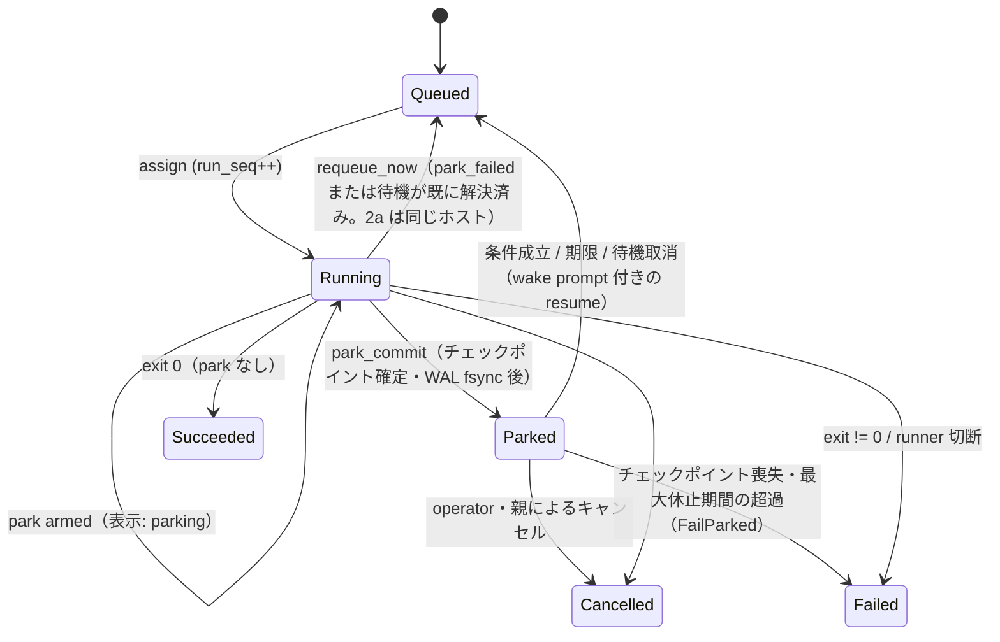
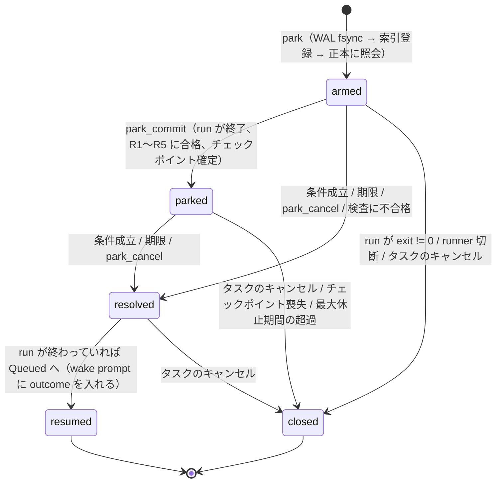
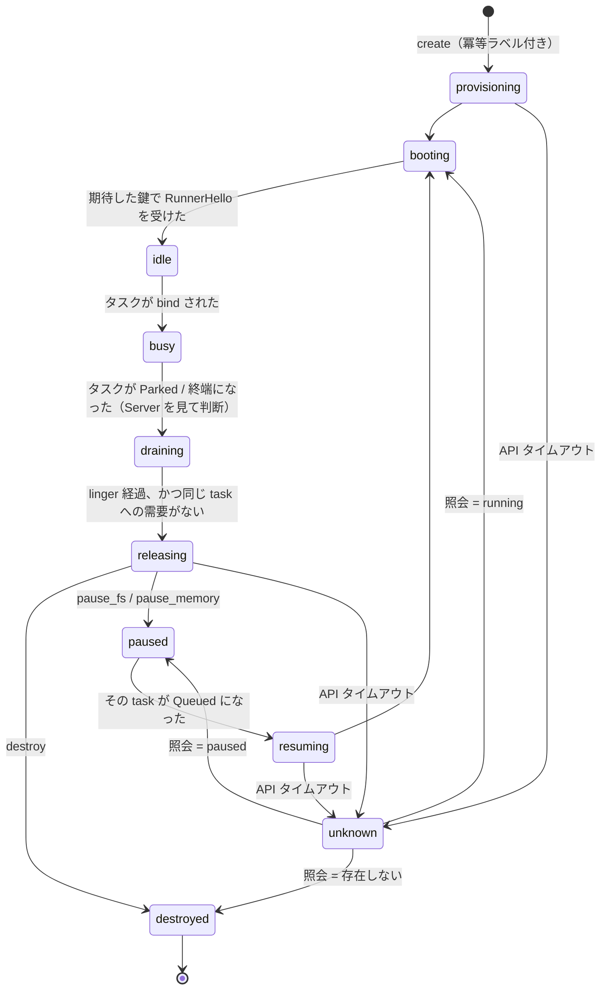
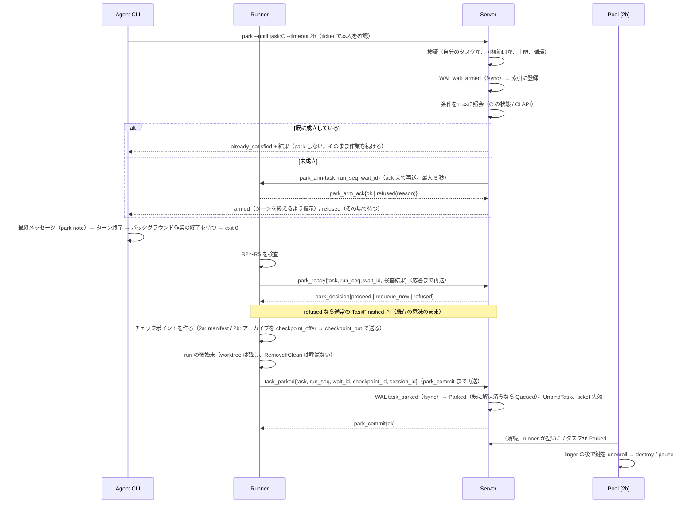
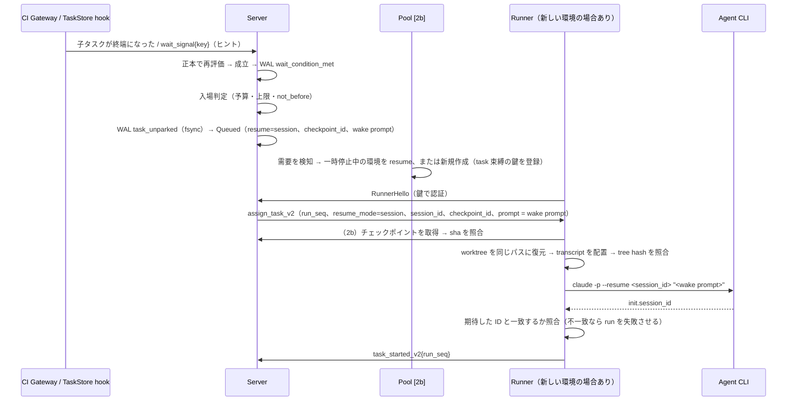

# 待機中タスクの実行資源解放と安全な再開（Task Park）— 設計

- 日付: 2026-11-11
- Status: **提案（設計のみ、未実装）**。本文の決定はすべて `this spec`（著者の提案）で、operator が決めたものはまだない。operator の判断が要る点は §8 に暫定判断付きで並べた。
- 対象コミット: `bc5519a610768903615ff9d18eb99cff54f14632`。2026-11-11 時点の `origin/main` と同じ SHA で、前回調査のコミットとも同じなので、前回からの差分はない。行番号はすべてこのコミットのもの。
- 用語: 本書の「park」はタスクの待機休止を指す。`2026-09-06-file-transfer-without-server-decrypt-design.md` に出てくる trsf 送信ループの「park」とは関係ない。

凡例:

- 状態区分: **[実装済]** / **[文書のみ]**（spec にだけある） / **[拡張]**（既存機能の拡張で実現できる） / **[新規]** / **[未確認]**
- 根拠: `path:line` はコードを読んだもの。「公式」は公式文書（取得日 2026-11-11、URL は付録 A）。「推論」は著者の推論。「仮定」は試算用に置いた値。「目標」はこれから達成する値で、実測値ではない。

---

## 0. 結論

### 0.1 この Harness に追加する妥当性

追加は妥当と判断する。土台の大半が既にあるからで、以下はすべてコードで確認した。

1. タスク ID を保ったまま worktree ブランチを付け直し、会話を再開して再実行する経路がある。`TaskStore.Resume`（`server/taskstore.go:659`）、同じパスへの worktree 再接続（`runner/worktree.go:25-57`）、`AssignTaskBody.resume_conversation`（`runner/protocol/message.bgn:298-311`）。park は、この経路を「終端状態を経由しない・自動・永続・別ホスト可」にした拡張として書ける。
2. 「生きているが runner に紐付かない」非終端状態として `Held` の前例がある。WAL 記録、期限、再取り込み、キャンセル、切断時の失敗化からの除外が揃っている（`message.bgn:873-889`、`server/taskstore.go:964`、`server/taskstore.go:1463-1482`）。
3. 実行ごとの資格情報（agentboard ticket）は割り当てのたびに新しく発行され、終了時に失効する（`server/server.go:1750-1754`、`server/runner_handler.go:309-324`）。
4. 子孫数の上限は状態に関係なくレコード数で数えている（`server/spawn_limit.go:122-155`）。そのため、待機で実行枠が空いても上限は迂回できない。

足りないのは次のものである。永続的な待機レコード、セッション ID を指定する会話再開、実行世代（run）によるフェンシング、ホストをまたいで運べるチェックポイント、Sandbox の作成と解放を担う外部コントローラ、予算と入場の制御、CI イベントの受付。

### 0.2 推奨 MVP

**方式 A（協調的終了＋永続チェックポイント＋セッション ID 指定の会話再開）を採る。**

- 安全な停止地点は次の時点とする。エージェントが `harness-cli park` で待機を宣言してターンを終え、CLI プロセスが exit 0 で終わり、Runner の機械的な検査（§4.4 の R1〜R5）を通った時点。モデルの自己申告は待機の意思表示としてだけ使い、停止の安全性は Runner の検査で担保する。
- `PreToolUse` の `permissionDecision: "defer"` には依存しない。存在はするが、前提とした意味とは違う（§2.5）。
- 段階は三つに分ける。Phase 1 は可視化だけ。Phase 2a は同一ホスト内での park で、runner スロットを解放する。Phase 2b は持ち運べるチェックポイント、Sandbox Pool Controller、CI 待ちを加える。
- Provider のメモリ付き休止（方式 B）は、チェックポイントを取った後に環境を安く保持する手段としてだけ使う。能力のある Provider でだけ有効にし、必須にはしない。

### 0.3 初期段階では作らないもの

- 方式 C1 / C2（LLM 推論待ちの節約）。Phase 3 の独立実験に切り出す。
- 対話型（PTY）セッションの park。人間が attach する経路は MVP の対象外とする。
- 分散 DB、分散ロック、汎用 Workflow Engine、Server の冗長化。単一 Server と WAL（fsync を追加する）で足りる。月 10,000 ジョブで park が 1.5 回/ジョブなら、park と起床に伴う fsync 付きの WAL 書き込みは月 3 万〜5 万件程度で、平均 1 分あたり 1 件程度にしかならない（推論。V8 で fsync の所要時間を測る）。タスクの状態は既に単一の TaskStore のロックで直列化されているので（`server/taskstore.go:164-165`）、park の遷移もその中に入れれば、分散ロックは要らない。
- 外部副作用の exactly-once 保証。
- 共通の `pause()` / `resume()` 抽象。Provider の能力は型で分けて表す（§4.10）。
- 1 Sandbox に複数の稼働タスクを詰める運用。

### 0.4 経済性の要約

試算用の仮定（§6）は、2 vCPU / 4 GiB の秒課金 Provider、月 10,000 ジョブ、ジョブあたり Sandbox 30 分、再実行 10% である。このときの計算資源費は月 $578〜$911 で、公式単価から算出した。休止で削れるのはこのうち待機の分だけなので、上限は月数百ドル規模になる。

**計算資源費の削減だけでは、Phase 2b の開発費と保守費を回収しにくい。** Phase 2b を進める根拠になりうるのは次の三つで、どれも Phase 1 の実測で判定する。

- (a) 待機が時間〜日の単位になり、Provider の稼働上限を超える。Docker cloud sandbox は作成から 24 時間、E2B Pro は連続稼働 24 時間が上限。
- (b) 課金とは別にある同時実行数の上限（quota）に当たる。
- (c) 固定予約プール（exe.dev の pool など）の収容数が足りない。

Phase 2a は既存のホストだけで成立し、同時に実行できるタスク数を増やす効果がある。そのため、計算資源費とは独立に価値がある。

---

## 1. 用語と数え方

| 単位 | 定義 | このリポジトリでの実体 | 関係 |
|---|---|---|---|
| Job（Issue） | 工程管理上の 1 件（GitHub Issue や仕様 1 件）。「月 1,000 / 10,000 タスク」はこの単位と解釈する | Harness の外（Factory Controller） | — |
| Harness task | TaskStore の 1 レコード。会話、worktree ブランチ `harness/<id>`、権限を持つ。再開しても ID は変わらない | `TaskEntry`（`server/taskstore.go:19`） | Job 1 : N task（親子） |
| Run（Agent 実行） | task を runner に 1 回割り当ててから、エージェントプロセスが終わるまで。割り当てごとに ticket が新しく出る | 現状は番号がない。本書で `run_seq` を新設する | task 1 : N run |
| Attempt | 失敗の後に同じ工程をやり直す run。park からの再開は Attempt に数えない | run の `kind ∈ {initial, continuation, retry}` で区別する（新設） | run の分類 |
| Sandbox | Provider 上の実行環境インスタンス。Provider の ID が生きている期間 | 現状はない（podman コンテナは run ごとに作られる） | run N : 1 sandbox（同時には 1 run） |
| 課金区間 | Sandbox が課金状態で連続していた区間（作成または再開から、休止または破棄まで） | 現状はない | sandbox 1 : N 区間 |

集計のルール（提案）:

- Sandbox の課金秒は課金区間から積み上げる。各区間を次の五つに分ける: (a) run 中、(b) park 処理中（チェックポイント作成と解放）、(c) 復元中、(d) 環境を保持したままの待機（linger、または休止しない場合）、(e) プールの空き待機。(a)〜(d) は task に、(e) はプールの経費に帰属させる。
- LLM 費用は run 単位の差分で数える。Claude Code は `--resume` した run で会話全体の累計を報告する（公式 headless: "When you continue an earlier conversation with `--continue` or `--resume`, the run reports the conversation's whole total, earlier runs' spend included"）。そのため単純に合計すると二重計上になる。この値はクライアント側の推定値でもある（同ページ）。
- retry run の費用は「無駄」として別に集計し、continuation run の費用は無駄に数えない。

---

## 2. 現状分析

### 2.1 対象コミット

`bc5519a6`（`spec: spawn limits amendment for the review's minors`）。前回調査のコミットと同じなので、設計に影響する差分はない。直前の 5 コミットは spawn limits 関連で、§5.5 の上限迂回防止はこれに乗る。

### 2.2 調査対象ごとの事実

| 対象 | 確認した事実 | 区分 | 根拠 |
|---|---|---|---|
| README | 単一開発者の dogfood 用のトイ。Server は task log、ファイル、PTY を平文で扱う trusted hub。transport は検証済みのセキュリティ境界ではない | [実装済] | `README.md:11-22` |
| Scheduler | 容量に空きがある runner ごとに、root、Selector、profile が合う Queued タスクを 1 件探し、`BindTask` → assign → `store.Assign` の順で処理する。定期的な tick はなく、変化イベントで動く。Running タスクを別 runner へ移し替える機能はない | [実装済] | `server/scheduler.go:62-131`、`server/server.go:1548` |
| Registry | runner の状態は Offline（接続なし）、Busy（`len(ActiveTasks) >= MaxTasks`）、Idle の三つ。**runner が切断すると、その runner の全タスクが `MarkFailed("runner_disconnected")` になり、ticket も失効する** | [実装済] | `server/registry.go:108-117`、`server/server.go:724-728`、`server/server.go:1719-1724` |
| 切断の検知 | peer ping 15 秒、死んだ peer の GC が約 65 秒 | [実装済] | `message.bgn:953-954` |
| idle_signal | Quiet は PTY 出力が閾値の間ないこと、Lifecycle は hook の報告が `working` 以外であること、Program は OSC 7501 が idle / done / blocked / error であること。どれも最後の入力より後の状態だけを数える。ターンが止まっているかの観測であって、プロセスを止めてよいかの判定ではない | [実装済] | `server/idle_signal.go:48-84` |
| await-idle | 対話セッションの SessionMux にワンショットの watcher を張る（sink は reply / notify / board）。mux のないタスクには NotFound を返し、watcher はメモリ上にしかない | [実装済] | `server/await_idle_handler.go:120-125`、`server/await_idle_handler.go:147-195` |
| lifecycle hook | すべて Async。`Stop` → idle、`PermissionRequest` / `AskUserQuestion` → waiting | [実装済] | `runner/settings.go:55-70` |
| Agent 起動 | テンプレートのトークンは `{args}` と `{prompt}` だけ。既定の再開は `--continue`。codex の preset は `exec --json resume --last` | [実装済] | `runner/agent_command.go:5-11`、`runner/resume_conversation.go:3-14`、`scripts/agent_presets.py:148` |
| stream adapter | 再開は `--continue`。ベンダーの `--session-id` は create-only（既にある ID には使えない）と計測済み。transcript は cwd を符号化したディレクトリの最新 jsonl から推定する。実際のセッション ID と食い違っても警告を出すだけで、run は続く | [実装済] | `runner/streamagent/claude.go:76-81`、`runner/streamagent/claude.go:112-116`、`runner/streamagent/claude_transcript.go:76-110`、`runner/streamagent/claude.go:456-467` |
| runner hold | **逆方向の仕組み**。Server を計画停止するときに、runner が子プロセスを生かしておく。arm してから detach する順で、期限は runner の単調時計。再接続時に `HeldTasksReport` で ticket を渡し、Server が受理または拒否する。拒否や期限切れのタスクは kill される | [実装済] | `runner/hold.go:385-405`（arm）、`runner/hold.go:463`（拒否されたものの kill）、`runner/hold.go:581-584`（期限切れの kill）、`runner/hold.go:551-623`、`server/readopt.go:51` |
| dispatch | publish の後、`in_reply_to` で相関した返信を同期的に待つ。コメントで「エージェントのターンループの外で使うシェル用ツール」と明記されている。エージェントがこれで待つと Bash の呼び出しが進行中のままになるので、park できない | [実装済] | `cli/agent/dispatch.go:44-215` |
| board wake | board に配信されると、Server が runner へ `task_wake` を送る。runner がなければ wake は捨てられ、メッセージは board に残って、次の UserPromptSubmit で読まれる | [実装済] | `server/agent_wake.go:56-76` |
| agentboard | 既定ではメモリ上にある（`chat.` 以外の topic は、operator の指定でディスクに retain できる）。ring は既定 64 件、最後の publish から既定 30 分で topic が消える。`chat.<id>` は retain できない。**長い待機の起床条件を board だけに記録すると失われる** | [実装済] | `cmd/harness-server/main.go:43-44`、`agentboard/board.go:611-637`、`docs/superpowers/specs/2026-10-30-agentboard-retention-design.md` §1-2 |
| WAL | JSONL 形式。書き込みごとに `bufio.Flush` するが fsync はしない。書き込みが失敗してもログを出すだけで、状態遷移は続行する。再生後、Running は `Failed("server_restart")` にし、Held は除外する | [実装済] | `server/wal.go:346-361`、`server/taskstore.go:860-864`、`server/taskstore.go:1463-1482` |
| ResumeConversation | WAL に書かれない（メモリのみ）。再開待ちの Queued タスクは、Server 再起動でこのフラグを失う | [実装済] | `server/taskstore.go:1004-1013` |
| TaskFinished | 受理するかは、その接続がタスクを `ActiveTasks` に持ち、かつ runner identity の現在の接続であるかで判定する（置き換えられた古い接続の報告はこれで落ちる）。run を区別する番号はない。`error_message :[..]u8` が残りのバイトすべてを取るので、末尾に追加できない。Finish は Cancelled を上書きする | [実装済] | `server/runner_handler.go:309-324`、`server/runner_handler.go:462-468`、`server/registry.go:304-317`、`message.bgn:388-391`、`server/taskstore.go:835-850` |
| ticket | 割り当てごとに 16 バイトの乱数を発行し、終了時に失効させる | [実装済] | `server/server.go:1750-1754`、`server/dispatch.go:210-217` |
| spawn limits | 作成時に、祖先の `max_descendants` を状態に関係ない子孫レコード数で検査する。prune は非終端のタスクを消さない | [実装済] | `server/spawn_limit.go:49-78`、`server/spawn_limit.go:122-155`、`server/taskstore.go:1493` |
| 予算 / 費用 | 予算を強制する仕組みはない。費用は stream の `Stats.CostUSD` と oneshot ログの `total_cost_usd` で観測しているだけで、Server では集計していない | [新規] | `runner/streamagent/proto.go:198-205`、`runner/agentlog/agentlog.go:253` |
| worktree | `<repo>/.harness-worktrees/<task>` に `harness/<task>` ブランチを作る。再開時は同じパスに付け直す。終了時、clean なら削除し、dirty なら残す。ブランチはローカルにしかない。**別ホストには何も残らない** | [実装済] | `runner/worktree.go:25-57`、`runner/session.go:845-862` |
| sandbox kit | runner はホスト上で動き、エージェントだけが rootless podman に入る（`--agent-bin` を差し替える）。worktree と共有 `.git` は同じ絶対パスで bind mount する。会話は host の `projects/` に書かれる。資格情報はホスト側のリレーが注入する。「敵対的なエージェントに対する境界として扱わない」と明記されている | [実装済] | `scripts/sandbox/README.md:289-298`、`scripts/sandbox/README.md:346-351`、`scripts/sandbox/README.md:573-646`、`scripts/sandbox/README.md:712-735` |
| kvm-runner | KVM ゲストを普通の runner ホストとして参加させる手順だけがある。Harness 側はゲストの作成や停止を知らない | [実装済] | `scripts/kvm-runner/README.md` |
| CI 連携 | webhook、check_run、workflow_run の処理はない（`grep` で該当なし。ただし検索で見つからないことは、存在しないことの断定ではない） | [新規] | — |
| runner からのアップロード経路 | Server が bidi stream を作り、runner がそれを待って読み書きする形は file transfer で使われている。チェックポイントのアップロードに転用できるかは計測していない | [未確認] | `runner/file_transfer.go:216`、`runner/session.go:913` |

既存機能の拡張で実現できるもの（[拡張]）:

| 既存の機能 | 本設計での使い方 | 根拠 |
|---|---|---|
| `TaskStore.Resume`（同じ ID で Queued に戻す） | Parked から Queued への再キュー（Unpark） | `server/taskstore.go:659-750` |
| `Held`（非終端、WAL、期限、切断で失敗化しない） | `Parked` の状態設計 | `server/taskstore.go:964`、`server/taskstore.go:1463-1482` |
| run ごとの ticket | run に束縛した資格情報と、park 時の失効 | `server/server.go:1750-1754` |
| `runner enroll` / `unenroll` | 環境ごとの使い捨て runner 鍵 | `server/runner_keys_handler.go:29`、`server/runner_keys_handler.go:71` |
| lifecycle hook（Stop） | `background_tasks` と `session_crons` の件数報告（R3） | `runner/settings.go:61` |
| spawn limits の合成規則（祖先の最小値） | 予算の継承 | `server/spawn_limit.go:49-78` |
| selector の `by_hostname` | 2a の再開先の固定 | `message.bgn:1173-1183` |
| history-window の「窓」 | 会話データの保存範囲 | `docs/superpowers/specs/2026-10-26-sandbox-history-window-design.md` §3 |
| Server が作る bidi stream（file transfer） | チェックポイントの転送 | `runner/file_transfer.go:216`（転用できるかは [未確認]、V7） |
| stream adapter のセッション照合 | 再開時のセッション ID 照合（警告を失敗に変える） | `runner/streamagent/claude.go:456-467` |

区分のうち [文書のみ] に当たるもの（spec はあるがコードがないもの）は、今回の調査範囲では見つからなかった。調査対象の機能は、どれもコードと呼び出し元まで確認できた。ただし、検索で見つからなかったことは、存在しないことの断定ではない。

### 2.3 「Idle」「Waiting」と「休止準備完了」の区別

| 表示 | 意味 | 出所 | 休止の根拠になるか |
|---|---|---|---|
| RunnerStatus Idle | runner の容量に空きがある | `server/registry.go:108-117` | ならない。タスクの状態とは無関係 |
| Lifecycle idle | 直前のターンが終わり、次の入力を待っている（Stop hook） | `runner/settings.go:61` | ならない。Async なので遅延や順序の逆転が起きる（2026-10-27 spec D10）。Stop の時点でバックグラウンド作業が残っていることもある（公式 hooks: Stop の入力に `background_tasks` があるのはこの区別のため） |
| Lifecycle waiting | 権限確認や質問への回答待ち | `runner/settings.go:57-60` | ならない。ツール呼び出しが終わっていない |
| Program idle / blocked | OSC 7501 による自己報告 | `server/idle_signal.go:78-84` | ならない（理由は同上） |
| await-idle Quiet | PTY の出力が閾値の間ない | `server/await_idle_handler.go:16-21` | ならない。ビルド中も出力が止まることがある |
| **休止準備完了（本書で新設）** | §4.4 の R1〜R5 を Runner が確認した | 新規 | **なる（唯一の根拠）** |

### 2.4 前の議論から訂正・撤回する前提

1. 「`defer` で未完了のツール呼び出しを保留できる」は**部分的に訂正**する。機能は存在するが条件付きである（§2.5）。MVP はこれに依存しない。
2. 「既存の会話再開で正しい会話に戻れる」は**撤回**する。どの preset も `--continue` か `--last` を使い、ID を指定できない（§2.2）。公式文書によれば、`-p` で作ったセッションは対話の `claude --continue` の対象外になる（公式 sessions: "Claude Code leaves sessions created with `claude -p` … out of the session picker and out of `claude --continue`"）。現行の対話での再開は `--continue` を付ける（`runner/resume_conversation.go:3-14`）。このため、oneshot で始めたタスクを対話で再開すると、別の会話を拾うか新しい会話になる可能性がある（推論。計測はしていない）。
3. 「idle 検出を休止の判定に使える」は**撤回**する（§2.3）。
4. 「Hold の仕組みで Runner 側の休止も扱える」は**訂正**する。Hold は逆方向で、Server が止まっている間に子プロセスを生かしておく仕組みである。Runner や環境が消えると、現状ではタスクが失敗扱いになる。ただし、非終端状態、WAL、期限、再取り込みの設計は流用できる。
5. 「board に届いたメッセージで後から起こせる」は**訂正**する。board は既定でメモリ上にあり、`chat.<id>` は retain できず、TTL は 30 分なので、長い待機の起床条件の記録には使えない。
6. 「WAL があるので永続化は済んでいる」は**部分的に訂正**する。WAL は fsync せず、書き込みが失敗しても止まらない。資源を解放する前提にする記録には、fsync と、失敗したときの中止が必要である。
7. 「メモリ付きで休止すれば通信もそのまま続く」は**撤回**する。E2B の公式文書には休止時に "all the clients will be disconnected" とある。Runner の接続は切れ、現状では切断するとタスクが失敗扱いになる。
8. 「月 10,000 タスクなら自前の基盤へ移行」は**撤回**する。§6 のとおり、判断は稼働率と実測の削減額で行う。
9. 過去の回答に出たベンダーの価格と復帰時間は**使わない**。本書の数値は §2.5 で 2026-11-11 に取得した公式ページのもの。

### 2.5 外部仕様の確認結果

#### Claude Code（ローカルは 2.1.322。公式文書は最新版を記述している）

| 主張 | 判定 | 公式の記述（要旨。原文は付録 A のページ） |
|---|---|---|
| PreToolUse の `permissionDecision: "defer"` | **存在する。ただし条件付き** | 値は allow / deny / ask / defer。"Claude Code honors `"defer"` only in non-interactive mode with the `-p` flag, and only when Claude makes a single tool call in the turn"。対話では警告して無視し、同時に複数のツールを呼んだ場合も無視して通常の権限フローに進む（hooks "Defer a tool call for later"） |
| `stop_reason: "tool_deferred"` | **存在する** | "The turn ends with a result carrying `stop_reason: "tool_deferred"`, and the pending tool call stays in the transcript"。`deferred_tool_use` に `id` / `name` / `input` が入る（同上） |
| `claude -p --resume <id>` で保留中の呼び出しを再開する | **条件付きで正しい** | 再開すると同じ呼び出しで PreToolUse がもう一度発火し、hook が `allow` と `updatedInput` を返したときだけ実行される。"If you sent a prompt with that resume, Claude answers it without the tool's result and doesn't run the call"。MCP サーバーがない場合は `tool_deferred_unavailable` になる。v2.1.319 より前は呼び出しが落ちる（同上） |
| プロセスが落ちた後の再開 | **未完了の呼び出しは再実行されない** | "a tool that was still running when the previous process ended, for example in a crash, doesn't get rerun when you resume"（sessions）。SIGTERM の場合は進行中のターンを未完了のまま残し、Bash のプロセスツリーを終了させて exit 143 で終わる（headless "Stop a run with SIGTERM"）。SIGKILL 時の整合性は記載がない [未確認] |
| `-p` での ID 指定再開 | **できる** | `claude -p "…" --resume "$session_id"`。"You can run the two commands from different directories"（headless）。ID は現在のプロジェクト、次に他の全プロジェクトの順で探す。重複したコピーがあると not found になる（sessions "Resume by session ID"） |
| `--session-id <uuid>` | 存在する | "Use a specific session ID for the conversation"（cli-reference）。既にある ID には使えないことを repo で計測済み（`runner/streamagent/claude.go:76-81`） |
| transcript の保存先 | `~/.claude/projects/<project>/<session-id>.jsonl` | `<project>` は cwd の非英数字を `-` に置き換えたもの。200 文字を超えると切り詰めてハッシュを付ける。"The entry format is internal to Claude Code and changes between versions"（sessions "Where transcripts are stored"） |
| `-p` の終了時の待機 | **終了前にバックグラウンド作業を待つ** | ターンが終わって stdin が閉じた後も、メイン会話が始めたバックグラウンドコマンド、subagent、Monitor、/loop の wakeup を待つ。既定ではアイドルが 10 分続くと残りを止めて部分結果を捨てる（`CLAUDE_CODE_PRINT_BG_WAIT_CEILING_MS`）。MCP のバックグラウンド作業は待たない（headless "Background tasks at exit"） |
| Stop hook の入力 | `background_tasks` と `session_crons` がある | "let hooks distinguish "session is done" from "session is paused waiting for background work to wake it back up""（hooks "Stop input"） |

`defer` に依存しない理由は四つある。

1. 有効なのは `-p` で 1 ターンに 1 つのツール呼び出しのときだけで、並列に呼ぶと黙って無効になり、通常どおり実行されてしまう。
2. 保留されるのはツール呼び出し 1 件だけで、待機条件、期限、イベントの受付、チェックポイントは何も提供されない。
3. Claude Code 固有の機能で、Codex などには相当するものが見当たらない（下表）。
4. 再開時にも同じ MCP サーバーと権限ホストが必要になる。

そこで、「park を deferred tool call として表し、再開時に待機の結果をツールの結果として返す」案は、Phase 2b 以降に任意で行う最適化の検証項目（§7.7 V9）として残す。

「ツール実行を拒否する」「CLI を強制終了する」「会話を再開する」と、「未完了のツール呼び出しを安全に保留して再実行できる」とは別物である。本設計は後者を仮定せず、**ツール呼び出しが完了してターンが終わり、プロセスが正常に終了した時点**だけを停止点にする。

#### 他のエージェント CLI

| CLI | ID 指定の再開（非対話） | セッション ID の入手 | 保存場所と cwd 依存 | ツール呼び出しの保留 | 確認方法 |
|---|---|---|---|---|---|
| Codex 0.167.0 | `codex exec resume <SESSION_ID> [PROMPT]`。`--last` は別のフラグ | `thread.started` の `thread_id` | `$CODEX_HOME/sessions/` のロールアウトと SQLite 索引。`--last` は cwd でフィルタする | 見当たらない | ローカルの `codex exec resume --help` と公式文書（learn.chatgpt.com） |
| Gemini CLI | `gemini -r "<session-id>"` | `init` イベントの `session_id` | `~/.gemini/tmp/<project_hash>/chats/`（プロジェクトごと） | 対話でだけ部分的にある | 公式文書（調査エージェント経由。要再確認） |
| agy | `agy -p … --conversation <id>` | `init` の `conversation_id` | 実体の場所は記載がない | 見当たらない | 同上 |
| opencode | `opencode run --session <id>`。ローカルの help には「なければ作る」とある | `--format json` の各行の `sessionID` | `opencode.db`（SQLite） | あいまい | ローカルの `--help` と公式文書（要再確認） |

repo 側の前提との食い違い（`scripts/agent_presets.py` と照合した）:

- すべての preset が「最新」で再開している。cwd が変わると、Codex の `--last` は黙って新しいスレッドを始める（公式ソースによる。調査エージェント経由）。
- Codex の対話用テンプレートは `resume --last` だが、これが `exec` で始めたセッションを拾うかどうかは公式文書の上でも条件付きである。

#### Sandbox Provider（2 vCPU / 4 GiB 換算、2026-11-11 取得）

| | E2B | exe.dev（standalone VM） | Docker Sandboxes（cloud） |
|---|---|---|---|
| 休止で保存されるもの | 既定ではメモリとファイルシステム（"all running processes, loaded variables"）。`mode: 'filesystem'` なら FS だけで、再開時に再起動する | メモリをディスクへスナップショットする。再開後も "processes that were running are still running" | sandbox ごとに discard（ディスクのみ）か preserve（メモリも）かが決まる（API の `StopMemoryOutcome`）※ |
| 同じ ID での復帰 | `connect(id)` で再開する（ID が不変だという明記はない） | VM 名で再開する | "Resuming keeps the sandbox ID and state" |
| 別環境への複製 | snapshot から複数の新しい sandbox を作れる | copy はディスクだけで、メモリは複製しない | `RestoreSnapshot` で新しい sandbox に fork する ※ |
| 休止中の課金 | "compute billing stops immediately" | standalone の停止中や休止中は CPU とメモリに課金しない。**pool は存在する限り課金される** | "A paused sandbox costs nothing" |
| 単価 | $0.000014/vCPU 秒 ＋ $0.0000045/GiB 秒 = **$0.1656/時**（換算は著者） | **$0.105/時**（2 vCPU / 4 GiB の 1 unit、秒単位） | Small（2 vCPU / 4 GB）は **$0.14/時**（"Rates current as of September 2026"） |
| 休止と再開の時間（公式の記載） | 休止はメモリ 1 GiB あたり約 4 秒、再開は約 1 秒 | 自社テストで休止約 2 秒、再開約 3 秒。並列に 3 台作っても 2 秒未満で準備できた（いずれも "in our tests"） | 記載がない |
| 寿命と保持 | 休止中のものは無期限に保持される。連続稼働は Pro で 24 時間（休止でリセットされる） | 最大休止期間の記載がない | 既定の TTL は 1 時間。延長しても作成から 24 時間を超えられない |
| 休止時の接続 | "all the clients will be disconnected" | 記載がない | 記載がない |

※ の行は調査エージェント経由の情報で、本書の著者は直接確認していない。それ以外のセルは著者が公式ページで確認した。

設計への含意:

- すべての Provider で、休止すると接続が切れる前提で設計する。記載のある Provider はどれもそうなっている。
- 同じ ID での復帰、メモリの保持、新しい環境への複製、最大寿命、休止中の課金は Provider ごとに違う。§4.10 の能力型で表す。
- 固定予約（exe.dev の pool や Personal プラン）では、休止しても請求は減らない。

---

## 3. 方式の比較

### 3.1 比較表

| 観点 | A: 協調的終了 + チェックポイント + 会話再開 | B: 待機地点での VM 休止（メモリ付き） | C1: 制御を Sandbox の外へ出す | C2: 推論中継サービス |
|---|---|---|---|---|
| 停止点 | CLI の正常終了と Runner の検査 | A と同じ条件が要る（進行中の LLM 呼び出しやツール呼び出しがあると、接続が切れたときに壊れるため） | ツール実行の合間ならいつでも | LLM 応答待ちの最中 |
| 保存されるもの | worktree（git）、transcript、待機条件 | メモリ、プロセス、FS（Provider 次第） | 会話は外側にある | 応答は中継が保持する |
| 再開の正しさ | セッション ID で同じ会話に戻れる。進行中のツールはない | プロセスはそのまま。接続とトークンは張り直しが必要 | 自前のループの品質次第 | CLI の再試行の振る舞い次第 |
| Provider への依存 | 破棄だけで成立する | メモリ休止の能力が必須 | 実行 API だけ | 休止と中継の両方 |
| 既存コードとの距離 | 近い（resume 経路の拡張） | 中程度（Held の逆向き版が要る） | 遠い（既存の CLI を捨てる） | 遠い |
| 節約できる時間 | 損益分岐（§6.3）を超える待機 | 同上で、分岐点がもっと短い | 推論の待ち時間も含む | 推論の待ち時間 |
| 主なリスク | 依存の復元コスト、transcript 形式の版依存、パスの同一性 | 切断で失敗化、時計の扱いが未確認、メモリ内の資格情報がスナップショットに残る、寿命の上限 | 作り直しの規模 | 二重課金、順序、部分応答 |
| MVP | **採用** | 不採用（A の後に保持手段として任意で使う） | 不採用（長期の選択肢） | 不採用（Phase 3 の実験） |

### 3.2 方式 B の論点

- **復元の範囲**: Provider 次第である（§2.5 の表）。
- **通信、タイマー、期限付き認証**: 接続は切れる（公式）。休止後の時計の扱いは、確認した 3 社の文書にはどれも記載がなかった [未確認]。期限付きの認証には次のものがある。sandbox kit の claude アクセストークンは 8 時間で、ホスト側が更新する（`scripts/sandbox/README.md:583`）。ticket には期限がなく、失効だけがある。長く休止すると、アクセストークンの期限が切れる可能性がある。
- **計画休止と通常の接続断の区別**: 現状では区別できない（切断すると失敗化する）。B をやるなら、Held と対称な `Suspended` 状態を Server に足し、切断時の `MarkFailed` から除外して、再接続時に `HeldTasksReport` 相当で取り込み直す必要がある。
- **Runner の再登録**: Runner は再接続ループで再登録し、`Registry.Add` が identity を取り直す（`server/registry.go:186-222`）。既存タスクの引き取りは、readopt の経路（`server/readopt.go:51`）を一般化すれば書ける。
- **同じ Sandbox で他のタスクが稼働中の場合**: 全タスクが休止可能になるまで休止できない。実質的に 1 Sandbox 1 run が必須になる。

結論: B は停止点の条件を緩めず、Provider 依存と新しい状態を増やす。したがって B は、A で停止点とチェックポイントを確定させた後に、環境を安く保持するための任意の手段として位置づける（§4.10 の `pause_memory` 戦略）。

### 3.3 方式 C の論点（MVP には含めない）

- **C1**（制御、会話、LLM 呼び出しを Sandbox の外へ出す）は、既存の CLI（claude / codex）のツール実装と権限モデルを捨てて、自前のエージェントループを作ることになる。Harness の前提（`--agent-bin` で CLI を起動する）から外れるので、長期の選択肢として記録するにとどめる。
- **C2**（Sandbox 内の CLI はそのままにして、外側の中継がリクエストを継続する）:
  - TCP や SSE の接続を休止をまたいで維持することは期待できない。公式にも、休止時に接続が切れると記載されている（E2B）。
  - 再開後、CLI は壊れた接続を見て再試行する。中継が応答を保存していれば、同じリクエストの再送に保存済みの応答を返すことはできる。ただし、リクエストの同一性（本文のハッシュ）、並行リクエストの順序、部分的に受信した応答の破棄、CLI 側のタイムアウトと自動再試行の回数がすべて CLI の非公開の挙動に依存する。
  - 中継が落ちれば推論結果を失い、再推論で二重に課金される。中継は常時稼働になり、可用性も保証しなければならない。
  - 既存の資格情報リレー（`sandbox-connect-proxy relay`。`scripts/sandbox/README.md:573-646`）とは別物である。既存のリレーはリクエストごとに資格情報を足して流すだけで、状態を持たない。C2 の中継は、クライアントとの接続が切れた後もリクエストを続け、応答を保存し、再送を重複として判定する。リクエストの寿命を自分で管理する、状態を持つサービスになる。
  - 推論を待つ間も、他の作業は並行して進みうる。claude はバックグラウンドの subagent やコマンドを並行して走らせる（公式 headless "Background tasks at exit"）。メインの会話が推論を待っている間に、別の subagent が推論中、あるいはツールを実行中ということがある。このため「推論待ち」は Sandbox 全体の静止状態ではなく、1 本のリクエストの待ちにすぎない。休止すれば並行中の作業も止まる。
  - LLM 応答の待ち時間は通常数十秒から数分である（推論。計測は Phase 1）。§6.3 の分岐点（破棄なら約 2 分＋linger、メモリ休止でも約 30 秒＋linger）に対して余地が小さい。
  - Phase 3 で、Phase 1 の実測から LLM 待ちの比率が大きいと分かった場合に限り、E1〜E3（§7.4）の実験として切り出す。

### 3.4 推奨

方式 A を採る。理由は三つ。

1. 停止点を Runner が機械的に確かめられる。
2. Provider の「破棄」能力だけで成立する。
3. 既存の resume 経路と Held の設計をそのまま延長できる。

別案として「A で停止したうえで、Provider の休止（FS のみ、またはメモリ付き）で環境を保持する」ハイブリッドを §4.10 に戦略として含める。チェックポイントは常に取るので、休止した環境が失われたり期限切れになったりしても、持ち運べるチェックポイントから復元できる。

---

## 4. 設計

### 4.1 アーキテクチャ

```
  ┌──────── Sandbox（Agent が操作する領域）──────┐      ┌──────── 制御面（Agent から触れない領域）────────┐
  │ agent-runner  (uid runner, タスク束縛の鍵)   │◀────▶│ harness-server（単一、WAL + fsync）               │
  │   └ agent CLI (uid agent, podman は任意)     │ WS/  │   TaskStore / WaitManager / CheckpointStore       │
  │       └ harness-cli（run 単位の ticket）     │ UDP  │   Scheduler + Admission（予算・入場）            │
  └──────────────────────────────────────────────┘      │ harness-pool（Sandbox Pool Controller）[2b]       │
                                                        │   Provider Adapter（Provider API キーを持つ）    │
  GitHub ── webhook ──▶ harness-ci-gateway [2b] ──────▶ │ harness-ci-gateway（GitHub 読み取りトークン）    │
                                                        │ LLM 資格情報リレー（既存の inject の外置き）[2b] │
                                                        └───────────────────────────────────────────────────┘
```

Phase 2a では制御面は harness-server だけで、Sandbox は既存の runner ホスト（podman）のままである。

### 4.2 責務分担

| コンポーネント | 持つもの・行うこと | 持たないもの・行わないこと |
|---|---|---|
| harness-server | WaitRecord（条件、期限、状態）、`run_seq`、チェックポイントの台帳と本体（MVP）、再開の可否と入場の判定、期限のタイマー、子タスク条件の評価 | Provider の API キー、Sandbox の操作 |
| Runner / Agent Adapter | 停止点の検査（R2〜R5）、チェックポイントの作成と復元、セッション ID の取得と照合、エージェントの起動 | 待機条件の評価、起床の判断 |
| Sandbox Pool Controller（`harness-pool`）[2b] | Provider の API キー、環境の作成・休止・復元・破棄・照会、使い捨て runner 鍵の登録と失効、孤児の回収 | タスクの意味的な状態（Server から読む）、待機条件 |
| External Event Gateway（`harness-ci-gateway`）[2b] | webhook の署名検証、重複排除、正本（GitHub API）への再照会、Server への signal | タスクの状態、Provider |
| Admission / Budget（Server 内） | 再開時の入場、親子を合算した予算、再試行の上限、`not_before` | — |
| Factory Controller（Harness の外） | Issue からの root task 作成、品質判定（テスト結果とレビュー結果に基づく合否）、PR の作成、GitHub の書き込みトークン | park は、レビュー担当エージェントや CI の完了を待つ手段を提供するだけで、合否は判定しない |

原則: 起床の判断、タイマー、Provider のキーはすべて制御面に置き、休止させる Sandbox の中には置かない。

#### 1 Sandbox : 1 Runner : 同時 1 run の評価

**方式 A にとっては必要条件ではなく、初期の簡略化のための制約である。** A では run ごとに停止点とチェックポイントが閉じているので、複数の run が同居していても、全 run が Parked か終端になった時点で解放すればよい。それでも初期は 1:1:1 にする。理由は四つある。

1. 解放の判断が「その runner に bind されたタスクがない」だけで済む。
2. task に束縛した鍵（§5.4）で、同居するエージェントが他のタスクを受け取る経路を最初から塞げる。
3. 課金区間がそのまま run に帰属し、§1 の集計が単純になる。
4. 方式 B（メモリ付き休止）は全タスクが同時に休止可能であることを要求するので、1:1:1 が実質的に必須になる（§3.2）。

見直す条件: Sandbox の起動のオーバーヘッドが run の長さに比べて大きい場合（短いタスクが多い場合）。そのときも、まず同居ではなく、空いた Sandbox を少数待機させる（warm pool）方を検討する。

### 4.3 待機の分類と扱い

| 待機・処理 | 扱い | 条件の種別 | Phase |
|---|---|---|---|
| 外部 CI の完了待ち | park の対象 | `ci{repo, sha, filter}` | 2b |
| 子エージェントや別タスクの完了待ち | park の対象 | `task{ids, all\|any}` | 2a |
| 時刻待ち | park の対象（期限だけを持つ待機） | `time{not_before}` | 2a |
| 外部イベントや承認の待ち | 同じ機構の拡張 | `signal{key}`（Gateway か operator が通知する） | 2b+ |
| board メッセージの待ち | 同じ機構の拡張。到着したメッセージ本文を WaitRecord に取り込む（board の TTL 対策） | `board{topic, after_seq}` | 2b+ |
| Rate limit や利用枠の回復待ち | 環境を確保する**前**に待たせる。Queued に `not_before` を付け、Scheduler と Pool はこれを需要に数えない | — | 2b |
| LLM の推論応答待ち | 対象外（Phase 3 の実験） | — | 3 |
| Sandbox 内のビルドやテスト | 停止の対象にしない（park を拒否する） | — | — |
| 出力がないだけの状態 | 休止可能とはみなさない | — | — |

### 4.4 安全な停止地点（休止準備完了）

Runner が**すべて**を確認したときだけ、休止準備完了とする。

| # | 条件 | 確認の方法 | 根拠 |
|---|---|---|---|
| R1 | Server がこの task の現在の `run_seq` について、`armed` の WaitRecord を持っている | `park_arm` を受信し、ack 済みであること（§4.8） | 新規 |
| R2 | エージェント CLI のプロセスが exit 0 で終わった。stream 種別では、`result` を受けてから stdin を閉じ、exit 0 で終わったこと | プロセスの終了コード | claude `-p` は終了前にバックグラウンド作業を待つ（公式 headless）。park 対象の run では `CLAUDE_CODE_PRINT_BG_WAIT_CEILING_MS=0` を設定する（公式 headless: "set it to `0` to wait without one"）。実際にそう振る舞うかは V2 で確かめる。run 全体の上限時間は Runner が別に持つ |
| R3 | 最後の Stop hook の `background_tasks` と `session_crons` が空だった（claude） | 注入済みの lifecycle hook がこの 2 配列の件数も報告する（`runner/settings.go:61` を拡張） | 公式 hooks "Stop input" |
| R4 | エージェントのプロセス区画に生き残りがない | ホスト実行では cgroup か process group を確認する。podman では、現行のランチャーがエージェントを `exec` するので（`scripts/sandbox/agent-launch.sh:59`）、エージェントの終了後に検査できる者が残らない。そこで park 対象の run（oneshot と stream で、TTY を使わない）に限り、ランチャーを fork + wait に変え、エージェントの終了後に残ったプロセスを列挙して報告させる。TTY の前面プロセスグループの扱いは対話経路だけの問題なので、この変更の対象外にできる | 新設。終了コードとキャンセル時の SIGTERM の伝播は V3 で確かめる |
| R5 | git の状態をチェックポイントにできる。進行中の merge / rebase / cherry-pick / bisect がなく、`index.lock` もない | `MERGE_HEAD`、`rebase-merge/`、`rebase-apply/`、`CHERRY_PICK_HEAD`、`BISECT_LOG`、`index.lock` の有無 | 新規 |

ひとつでも満たさなければ park は**拒否**する。Server は `park_decision{requeue_now}` を返し、outcome=park_failed で即座に再キューする（§4.6）。

Runner が保証しないこと（明記しておく）:

- 既に行われた外部の副作用（push、API 呼び出し、PR コメント）。チェックポイントはこれらを記録しないし、取り消しもしない。
- エージェントが起動した、プロセス区画の外にある作業。CI ジョブ、別のタスク、リモートのジョブは続く。これは意図どおりで、待つ対象そのものである。
- MCP のバックグラウンド作業。claude `-p` はこれを待たない（公式 headless）。MVP では、park できる profile に長時間の MCP タスクを使わないことを運用上の制約とする。
- エージェントの判断の正しさ。`park` の呼び出しは意思表示であって、停止の安全性の根拠にはしない。

### 4.5 状態遷移

#### タスク（`TaskStatus`）

`Parked` だけを新しい値として末尾に追加する（`Held` と同じやり方）。ユーザーが提案した Parking / Waiting / Ready は次のように対応させる。

- Parking: `Running` に、`armed` の待機が付いた状態（表示上の副状態）
- Waiting: `Parked`
- Ready: `Queued`（resume の印付き。入場待ちを含む）

Parking と Ready を `TaskStatus` に足さない理由: Parking 中も ticket は有効で、runner が所有しており、キャンセルも届く。つまり Running と同じに扱うべきである。Ready は Scheduler にとって Queued と同じ意味である。値を増やすと、`Cancel`、`MarkFailed`、`Prune`、`Resume`、`ReplayEvents` など TaskStatus の分岐をすべて直す必要がある。runner を持たず、終端でもなく、Queued でもない状態は Parked だけである。



#### 待機レコード（WaitRecord）



- `resolved` は outcome（satisfied / timeout / cancelled / park_failed）を持ち、必ず再キューにつながる。`closed` は再キューしない終わり方で、close_reason（run_failed / park_interrupted / task_cancelled / checkpoint_lost / max_park_exceeded / runner_unsupported）を持つ。待機だけを取り消して起こす（`park_cancel`）ことと、タスクごと取り消すことを、別の状態として扱う。
- armed のまま条件が成立し、run がまだ進行中のときは resolved で待つ。その run が exit 0 で終われば、park せず（チェックポイントも取らず）、`park_decision{requeue_now}` で即座に再キューする。
- ラッチ: 条件は一度成立したら戻らない。CI が再実行されて in_progress に戻っても、待機は成立したままにする。
- 1 つのタスクにつき、非終端の WaitRecord は同時に 1 件まで。

#### 実行環境（Pool Controller が管理する、2b）



タスクの状態（Server が持つ）と環境の状態（Pool が持つ）は分けて管理する。Pool はタスクの状態を Server から読むだけで、書き込まない。

### 4.6 シーケンス

#### 待機の登録 → 停止 → 解放



終了時に park するかどうかは、`park_ready` に対する Server の `park_decision` で一つに決まる。arm の ack がタイムアウトした後で runner が arm した場合のように、両者の認識がずれていても、ここで揃う。

#### 起床 → 入場 → 復元 → 再開



### 4.7 データモデル

#### WaitRecord（Server が持ち、WAL に記録する）

| フィールド | 型 | 説明 |
|---|---|---|
| `wait_id` | [16]byte | 乱数 |
| `task_id` | TaskID | 待機する本人 |
| `armed_run_seq` | u32 | 登録した run |
| `created_at` / `deadline` | unix ns（Server の時計） | 期限は必須。省略すると profile の既定（暫定 24 時間）、上限は §8 Q4 |
| `mode` | all / any | 複数の条件をどう結合するか |
| `conditions[]` | `task{id}` / `ci{repo, sha, filter}` / `time{not_before}` / `signal{key}` / `board{topic, after_seq}` | 各条件は `pending` / `met` と証跡（上限 4 KiB の JSON）を持つ |
| `note` | string ≤ 4 KiB | エージェント自身が書く引き継ぎメモ |
| `state` | armed / parked / resolved / resumed / closed | §4.5 |
| `outcome` | satisfied / timeout / cancelled / park_failed | resolved のとき。再開時の wake prompt に入れる |
| `close_reason` | run_failed / park_interrupted / task_cancelled / checkpoint_lost / max_park_exceeded / runner_unsupported | closed のとき |
| `checkpoint_id` | sha256 | parked のとき必須 |
| `resumed_run_seq` | u32 | 監査用 |

#### チェックポイントの manifest

```json
{
  "checkpoint_id": "sha256:…",
  "kind": "local | portable",
  "task_id": "…", "run_seq": 7, "wait_id": "…",
  "created_at": "2026-11-11T09:00:00Z",
  "repo": {
    "root_path": "/srv/repos/app", "remote_url": "…",
    "base_commit": "…", "branch": "harness/<task>", "head_commit": "…",
    "index_tree": "…", "worktree_tree": "…",
    "bundle": {"sha256": "…", "prerequisites": ["<base_commit>"]}
  },
  "agent": {
    "profile": "claude", "vendor": "claude", "version": "2.1.322",
    "session_id": "…", "cwd": "/srv/repos/app/.harness-worktrees/<task>",
    "files": [{"path": "projects/<enc-cwd>/<session>.jsonl", "sha256": "…", "size": 0}]
  },
  "env": {"template": "…", "image_digest": "…"}
}
```

`worktree_tree` には、一時的な index（`GIT_INDEX_FILE`）で `git add -A` した結果を入れる。これで追跡中と未追跡（ignore されていないもの）の両方が含まれ、利用者の index と HEAD は動かさない。`index_tree` は本物の index を `write-tree` したもので、staged と unstaged の区別を保つために使う。

#### RunRecord（Phase 1 から作る台帳）

`task_id`、`run_seq`、`kind`（initial / continuation / retry）、`runner_identity`、`sandbox_ref`（2b）、`assigned_at`、`started_at`、`ended_at`、`end_reason`（finished / failed / parked / cancelled / park_failed）、`exit_code`、`durations{llm_ms, tool_ms_by_class, turn_idle_ms, blocked_ms}`、`cost_usd_delta`、`tokens`、`checkpoint_bytes`、`park_overhead_ms{check, build, upload, commit}`。

保存先は `<data-dir>/runs.jsonl` とする（WAL とは別の追記専用ファイル）。

#### TaskEntry への追加

`RunSeq u32`、`SessionID string`、`AgentVersion string`、`CheckpointID`、`WaitID`（非終端のもの）、`ParkCount u32`、`MaxParks u32`（2a、既定 20）、`ResumeMode`（none / continue / session）、`NotBefore int64`、`AdmissionBlocked string`（入場が保留された理由）、予算フィールド（2b、§5.5）。

`ResumeConversation` も WAL に記録するよう改める（§2.2 で WAL に書かれないことを確認した）。

#### 追加する WAL イベント

`wait_armed`、`wait_condition_met`、`wait_cancelled`、`task_parked`（`wait_id`、`checkpoint_id`、`run_seq`、`session_id`）、`task_unparked`（`wait_id`、`outcome`、wake prompt、`resume_mode`）、`park_failed`、`session_bound`、`checkpoint_deleted`。

既存の `task_assigned` には `run_seq` を追加する。`wait_armed`、`task_parked`、`task_unparked` は `WAL.WriteSync`（新設、`f.Sync()` まで行う）で書き、書き込みに失敗したら遷移しない（`wait_armed` の失敗はエージェントに refused を返す）。`wait_condition_met` は fsync しない。失っても、再起動後の再評価（§5.2 S19）で同じ結論になるからである。

### 4.8 インターフェース

#### wire（`runner/protocol/message.bgn`）

既存の形式（`AssignTaskBody`、`TaskStarted`、`TaskFinished`、`RunnerHello`）は**変えない**。両側とも `DecodeExact` で読むので（runner は `runner/connect.go:1104`、Server は `server/runner_handler.go:119`）、形式を変えると、更新していない相手とのあいだで、park だけでなくタスクの実行そのものが止まる。例えば `AssignTaskBody` のデコードに失敗した runner は、ログを出して戻るだけで `TaskFinished` を送らない（`runner/connect.go:744-751`）。タスクは Running のままスロットを占有し続ける。このリポジトリは互換 shim を置かない方針だが、ずれで失うのはその機能だけにとどめる、という方針でもある（`implementation-pitfalls` Pitfall 10）。そこで、新しい情報は新しいメッセージ種別で運び、相手が対応を宣言したときだけ使う。

| 変更 | 内容 |
|---|---|
| 機能の宣言 | runner は登録の直後に `RunnerMessageType.runner_features{run_seq, park, session_resume, checkpoint_formats}` を送る。Server は `RunnerRequestType.runner_features_ack` を返す（ack まで数回再送する）。`RunnerHello` は登録経路（Pitfall 10 の例外経路）なので触らない。古い Server はデコードに失敗してログを出し、捨てる（`server/runner_handler.go:119-122`）。ack が来なければ、runner は旧来の動作だけを使う |
| `TaskStatus` | 末尾に `Parked` を追加 |
| `TaskControlKind` | `park`、`park_cancel`、`wait_list`、`wait_signal` を追加 |
| `ParkRequest` / `ParkResponse` | `deadline_ms`（0 は拒否）、`mode`、`conditions`、`note`。応答の status は armed / already_satisfied / refused / bad_request / not_found / limit で、`wait_id` と証跡を返す |
| `RunnerRequestType` | `assign_task_v2`（本文は `AssignTaskBodyV2`。既存の本文に `run_seq :u32`、`resume_mode`、`session_id`、`checkpoint_id`、`checkpoint_stream_id` を足したもの。`prompt` には wake prompt を入れる）、`park_arm{task, run_seq, wait_id}`、`park_decision{proceed\|requeue_now\|refused}`、`park_commit`、`checkpoint_put{stream_id}`（2b）、`runner_features_ack` |
| `RunnerMessageType` | `runner_features`、`park_arm_ack`、`park_ready`、`task_parked`、`session_bound`、`task_started_v2` / `task_finished_v2`（`run_seq` 付き）、`run_stats`（Phase 1）、`checkpoint_offer`（2b） |
| `TaskInfo` | `park_state`、`wait_id`、`wait_deadline`、`run_seq`、`park_count`、`admission_blocked` を追加（client 向けの表示） |

Server は、`runner_features` を宣言した runner には `assign_task_v2` を送り、`task_*_v2` で `run_seq` を照合する。宣言していない runner には従来どおり `AssignTask` を送り、そのタスクからの `park` にはすぐ refused を返す。この場合、使えなくなるのは park だけで、タスクは従来どおり動く。新しい要求の種別は宣言した runner にしか送らないので、旧 runner が未知の種別を受け取ることはない。

**制御メッセージは失われることがある。** 制御メッセージは objproto の datagram で、UDP 上では確認応答も再送もない（`docs/superpowers/specs/2026-10-06-cancel-over-unreliable-control-design.md`）。そこで park 系のメッセージはすべて応答が来るまで再送し、受け手は `(task, run_seq, wait_id)` をキーに冪等に処理する。終了時に park するかどうかは、Server の `park_decision` だけで決まる（§4.6）。そのため `park_disarm` は設けない。

`scripts/wire-skew-check.sh` が確認するのはハンドシェイクの回復だけである（`scripts/wire-skew-check.sh:9-30`）。Phase 1 で、旧 runner × 新 Server と新 runner × 旧 Server の両方で、通常の oneshot タスクが最後まで完了することを確かめる E2E のずれ試験を追加する（§7.5）。

#### CLI（agent 面と operator 面）

```
harness-cli park --until task:<id>[,task:<id>…] [--any] [--until ci:<owner/repo>@<sha>[:<check>]]
                 [--until time:<RFC3339>] --timeout <dur> --note-file <path>
harness-cli park cancel [<task>]          # 自分か、cancel scope 内の task。即座に起床する（outcome=cancelled）
harness-cli waits [--json]                # 待機の一覧（可視範囲のみ）
harness-cli wait signal <key> [--json payload]   # Gateway / operator 用（新しい capability を要求する）
harness-cli runs [--task <id>] [--json]   # Phase 1 の RunRecord
```

`park` が `armed` を返したら、エージェントはターンを終えなければならない。この規則は `.claude/skills/harness-cli/SKILL.md` に書く。エージェントがそのまま作業を続けても安全側に倒れる。park は終了時にしか成立せず、その間に条件が成立していれば、終了したときに即座に再キューされる。

#### Provider Adapter（Go、2b）

```go
// 必須の能力。破棄だけで方式 A は成立する。
type Provider interface {
    Name() string
    Create(ctx context.Context, spec CreateSpec) (SandboxRef, error) // spec.IdempotencyLabel は必須
    Get(ctx context.Context, id string) (SandboxState, error)         // running / paused / stopped / absent / unknown
    List(ctx context.Context, label string) ([]SandboxRef, error)     // 孤児回収用
    Destroy(ctx context.Context, id string) error                     // 冪等
    Limits() Limits // MaxLifetime、MaxPausedDuration、ConcurrencyQuota、BillingWhilePaused（none / storage / full / unknown）、SameIDResume
}

// 任意の能力。型アサーションで判定し、ないものは使わない。
// 再開後に ID が変わる Provider もありうるので、再開は SandboxRef を返す（同じ ID が保証されるかは Limits.SameIDResume で宣言する）。
type FSPauser interface {
    PauseFS(ctx context.Context, id string) error
    ResumeFS(ctx context.Context, id string) (SandboxRef, error)
}
type MemPauser interface {
    PauseMemory(ctx context.Context, id string) error
    ResumeMemory(ctx context.Context, id string) (SandboxRef, error)
}
type Snapshotter interface {
    Snapshot(ctx context.Context, id string) (SnapshotRef, error)
    CreateFromSnapshot(ctx context.Context, s SnapshotRef, spec CreateSpec) (SandboxRef, error)
}
```

`CreateSpec` には、テンプレート、資源量、秘密でない環境変数、起動コマンド、runner の秘密鍵を渡す経路（Provider が対応していればファイル注入）を入れる。Provider の API キーは `CreateSpec` にもテンプレートにも入れない。

#### Agent profile の能力

`runner/agent_profile.go` と `scripts/agent_presets.py` に次を追加する。

| フィールド | claude | codex | その他 |
|---|---|---|---|
| `sessionSource` | `mint`（初回に `--session-id <uuid>` を付け、Server が UUID を発行する） | `report`（`thread.started` から取る） | `report`（取れなければ `none`） |
| oneshot テンプレート（初回 / 再開） | 初回は `--output-format stream-json --verbose {args} --session-id {session} -p {prompt}`、再開は `--output-format stream-json --verbose {args} --resume {session} -p {prompt}`（既存の preset の出力形式は残す。`scripts/agent_presets.py:130-131`） | 初回は既存の `exec --json {args} {prompt}`、再開は `exec --json resume {session} {args} {prompt}`（V5 で確かめる） | 個別に決める |
| `transcriptLocator` | `projects/<enc-cwd>/`（cwd 単位でまとめて保存） | `sessions/**/rollout-*-<id>.jsonl`（V5） | — |
| `exitWaitsBackground` | true（公式 headless） | 不明なので、R4 を厳しめに適用する | 不明 |
| `parkCapable` | 上の値から導く | 同左 | 既定は false |

テンプレートには `{session}` トークンを新しく足す（`runner/agent_command.go:5-8` を拡張）。`{session}` を含むテンプレートで session が空なら、展開時にエラーにする。

### 4.9 既存コードへの変更点

| ファイル | 変更 | Phase |
|---|---|---|
| `runner/protocol/message.bgn` | §4.8 の wire（新しい種別を足すだけ）。`scripts/protoregen.sh` で再生成し、`scripts/wire-skew-check.sh` と、タスクを最後まで流すずれ試験（新設）を通す | 1（`runner_features`、`run_stats`）、2a、2b |
| `server/taskstore.go` | `RunSeq`、`SessionID`、Parked への遷移（`MarkParked`、`Unpark`、`FailParked`）を追加。`Cancel` で Parked を扱う。`MarkFailed` の除外集合に Parked を足す（Held と同じ理由）。`SetResumeConversation` を WAL に書く。`ReplayEvents` で新しいイベントを扱い、Parked を掃き出しの対象から外す。リカバリ規則（§5.2 S8）は 2b で入れる | 2a / 2b |
| `server/wal.go` | `WriteSync`（fsync）と新しいフィールドを追加 | 2a |
| `server/wait.go`（新規） | WaitManager: 条件の索引（子タスク ID、CI キー、signal キー）、期限ヒープ、評価、ラッチ。WAL を再生した後、非終端のすべての WaitRecord を評価し直す（§5.2 S19） | 2a |
| `server/park_handler.go`（新規） | TaskControl の `park`、`park_cancel`、`wait_list`、`wait_signal` | 2a / 2b |
| `server/runner_handler.go` | `park_arm_ack`、`task_parked`、`park_failed`、`session_bound`、`run_stats` を受ける。`run_seq` が合わない報告は捨てる | 1 / 2a |
| `server/scheduler.go` | `eligible()` に `NotBefore`、入場判定、鍵の task 束縛（2b）を追加。期限が来たら Tick する | 2a / 2b |
| `server/server.go`、`server/task_handler.go` | フックをつなぐ（OnFinish / OnCancel で子タスク条件を評価）、タイマーループ。割り当ての 2 か所（`sendAssign`、`server/server.go:1741`、と open_exec の `server/task_handler.go:1949`）で、メッセージを組み立てる前に `run_seq` を確保して WAL に書く。宣言した runner には `assign_task_v2` で session と checkpoint を渡す | 2a |
| `server/agent_wake.go` | Parked のタスクに配信があったら、`board` 条件を評価する（2b+）。条件がなければログに残す | 2b |
| `server/checkpoint_store.go`（新規） | `<data-dir>/checkpoints/<task>/<sha>`。一時ファイル → fsync → 検証 → rename → ディレクトリ fsync。GC（終端になってから N 日後） | 2b |
| `server/runs.go`（新規） | RunRecord の台帳 | 1 |
| `runner/session.go`、`runner/streamtask.go` | oneshot と stream の終了処理で park に分岐する（TaskFinished の前に）。park の後始末（worktree を残し、`RemoveIfClean` を呼ばない。`runner/session.go:845-862`）は `task_parked` を送る前に終える。`assign_task_v2` の `run_seq`、session、checkpoint を扱う。interactive では park を拒否する | 2a |
| `runner/park.go`（新規） | arm の状態、R2〜R5 の検査、local manifest | 2a |
| `runner/checkpoint.go`、`runner/checkpoint_restore.go`（新規） | portable アーカイブの作成と復元（§5.3） | 2b |
| `runner/agent_command.go`、`runner/agent_profile.go` | `{session}` トークン、能力フィールド | 2a |
| `runner/streamagent/claude.go`、`claude_transcript.go` | `ResumeSession` を足し、`--resume <id>` で再開する。transcript を ID で特定する | 2a |
| `runner/agentlog/agentlog.go` | oneshot の init から session_id を取って `session_bound` を送る | 2a |
| `runner/settings.go` | Stop hook から `background_tasks` と `session_crons` の件数も報告する | 2a |
| `scripts/sandbox/agent-launch.sh` | park 対象の run（非 TTY）でだけ fork + wait にして、エージェントの終了後に生き残ったプロセスを報告する（R4） | 2a |
| `cli/prune_local.go` | `--before` の時間指定モードは、Server に問い合わせずに `git worktree remove --force` を実行する（`cli/prune_local.go:58-88`）。非終端（Parked を含む）のタスクの worktree は消さないよう変える | 2a |
| `scripts/wire-skew-check.sh` か新しいスクリプト | 旧 / 新の組み合わせで oneshot タスクを最後まで流す試験 | 1 |
| `scripts/agent_presets.py` | claude と codex の session 用テンプレートと能力フィールド | 2a |
| `cli/verb/table.go`、`cli/park.go`（新規）、`cmd/harness-cli` | `park`、`waits`、`wait signal`、`runs` | 1 / 2a |
| `tui/*`、`webui/static/main.js`、`cmd/harness-webui-wasm` | Parked の表示、待機の詳細、operator の操作（待機の取消、今すぐ起こす）。`surface-parity-checklist` を全部の欄について確認する | 2a |
| `.claude/skills/harness-cli/SKILL.md`、`supervising-workers/SKILL.md` | エージェントの待ち方（同期で待たずに park する） | 2a |
| `cmd/harness-pool`、`pool/…`（新規） | Pool Controller と Provider adapter（最初は local / kvm と、実 Provider を 1 つ） | 2b |
| `cmd/harness-ci-gateway`、`cigateway/…`（新規） | webhook と poller | 2b |

### 4.10 能力差とフォールバック

#### エージェント

| 能力 | 振る舞い |
|---|---|
| `parkCapable` = true | 方式 A をそのまま適用する |
| ID 指定の再開ができない | **引き継ぎ再開**（会話なし）に縮退する。worktree は復元し、park note と wake prompt を入れた新しい会話で始める。`TaskInfo` に `resume_mode=handoff` と表示する |
| セッション ID が取れない | park を拒否し、エージェントはその場で待つ |
| 対話（PTY）セッション | park を拒否する（MVP） |

#### Provider（環境の保持戦略）

| 戦略 | 必要な能力 | 選ぶ条件（暫定） | 起床時の動き |
|---|---|---|---|
| `linger` | なし | 期限や過去の実績から見て、待機が linger 時間（暫定 60 秒）未満と予想される | そのまま再割り当てする（復元しない） |
| `pause_memory` | `MemPauser` | 待機中の課金が `none` で、期限が `MaxPausedDuration` と `MaxLifetime` の残りに収まる | 同じ環境を再開する。worktree の tree hash を照合して使う（チェックポイントは保険） |
| `pause_fs` | `FSPauser` | 同上 | 同上（再起動されるので runner も起動し直す） |
| `destroy` | 必須 | それ以外、または休止が失敗したとき | portable チェックポイントから新しい環境に復元する |

**チェックポイントは、どの戦略でも必ず確定させてから環境を解放する**（不変条件 I3）。休止した環境が消えたり期限切れになったりしたら、`destroy` と同じ扱いに落とす。

休止や複製の直前には、Runner が `sync` を実行する。exe.dev の公式ガイドには、休止の直前に書いたファイルが、`sync` を足すまでコピー側で空だったという記述がある（"a file written just before the pause was empty in the copy until we added sync"）。

---

## 5. 正しさ・セキュリティ・復旧

### 5.1 不変条件

| # | 不変条件 | 担保する仕組み |
|---|---|---|
| I1 | 1 つのタスクで同時に進む run は高々 1 つ。現在の `run_seq` と違う報告は捨てる | `run_seq` を Assign で増やして WAL に記録し、報告ごとに照合する。既存の確認（タスクを持ち、かつ identity の現在の接続であること。`server/registry.go:304-317`）は残したまま重ねる。`run_seq` は、assign メッセージを送る前に確保して WAL に書く。Scheduler は送信した後で `store.Assign` を呼ぶので（`server/scheduler.go:113-129`）、`Assign` の中で増やすと、速い runner からの正当な報告を捨ててしまう |
| I2 | WaitRecord は前にしか進まない。成立はラッチされる | 遷移関数で一元化する |
| I3 | Parked のタスクには、確定済みのチェックポイントが必ずある（2a は local manifest、2b は portable） | `task_parked` の受理条件にする |
| I4 | 環境を解放するのは、Server が `task_parked` を fsync した後だけ | Pool は Server の Parked 状態を見てから解放する。2a では runner スロットの解放（`UnbindTask`）も同じ順序にする |
| I5 | 1 つの WaitRecord につき、Parked から Queued への再キューは 1 回だけ | TaskStore のロックの中で `resumed` への遷移と Queued 化を行い、WAL にも 1 レコードで書く |
| I6 | 再開した run のセッション ID は記録した値と一致する。一致しなければ、新しい会話で黙って続けずに run を失敗させる | `init.session_id` を照合する。既存の照合は警告を出すだけなので（`runner/streamagent/claude.go:456-467`）、失敗に変えて一般化する |
| I7 | park と起床で、権限と spawn limits は変わらない | 自動の再キューは `GrantUpdate` を使わない（`server/taskstore.go:716-728` の分岐に入らない） |
| I8 | run N のために発行した資格情報は、run N が終わった後に使えない | ticket は park 時に失効させる。LLM リレーのトークン（2b）は run に束縛する。使い捨ての runner 鍵は環境の解放時に unenroll する |
| I9 | 条件はレベルで判定する。イベントはヒントとしてしか使わない | §5.2 S1〜S6 |
| I10 | 待機には必ず期限がある | `deadline_ms = 0` は拒否する |

### 5.2 競合と障害への対応

| # | 状況 | 振る舞い |
|---|---|---|
| S1 | 待機を登録する前に CI が終わっていた | 登録の手順を「WAL に fsync → 索引に登録 → 正本に照会」の順にする。照会で成立していれば `already_satisfied` を返し、park しない |
| S2 | 登録した後、チェックポイントを作っている間や休止 API を呼んでいる間にイベントが来た | WaitRecord の成立をラッチする。`task_parked` を受けた時点で即座に Queued にする。環境の解放は Pool が Server の状態を見て決めるので、解放の前なら同じ環境を再利用し、後なら作り直す。linger 中ならそのまま再割り当てする |
| S3 | 同じイベントが複数回届いた | 成立済みや resumed の WaitRecord には何もしない。Gateway は `X-GitHub-Delivery` で重複を落とすが、これは最適化にすぎない |
| S4 | イベントが欠落した、または遅れた | Gateway が armed と parked の CI 条件を定期的に照会する（暫定 2〜5 分間隔、バックオフ付き）。期限のタイマーで、最終的には必ず起きる（outcome=timeout） |
| S5 | イベントの順序が逆転した | 再照会した正本の状態で判定する。成立した後は戻さない |
| S6 | 起床要求が一斉に集中した | Ready のタスクは Queued に入るだけ。入場判定と Pool の同時実行上限・作成レートで抑える。順番は Ready になった時刻の FIFO で、park から戻ったタスクを優先する |
| S7 | チェックポイントの保存中に Runner が落ちた | `task_parked` がないまま切断される。既存の `failAndRevokeTasksOf` で `Failed("runner_disconnected")` になる。WaitRecord は closed（`park_interrupted`）にする。以前の run で確定したチェックポイントがあれば、operator か親がそこから resume できる |
| S8 | チェックポイントを保存した後、`task_parked` を WAL に書く前に Server が落ちた | **2b のみ。** 再生時のリカバリ規則を適用する。Running かつ armed の待機があり、CheckpointStore に `(task, run_seq)` の確定済みチェックポイントがあれば **Parked にする**。なければ従来どおり `Failed("server_restart")` にする（`server/taskstore.go:1463-1482` を拡張する）。2a では manifest が runner 側にしかないので、従来どおり `Failed("server_restart")` にする。worktree と会話はホストに残っているので、operator か親が会話付きで resume できる |
| S9 | `task_parked` を fsync した後、環境を止める前に Server が落ちた | 再起動後、Pool が照合する。runner は再接続するがタスクは持っていない。環境は idle なので解放する。タスクは Parked のままで、二重に実行されることはない |
| S10 | Provider の操作がタイムアウトし、成功したか分からない | 環境を `unknown` にして `Get` で照会する。作成は冪等ラベルで探し直す。破棄はもう一度破棄する（冪等）。同じ task のために 2 つ目の環境を作ってしまった場合、両方の runner が登録しうる。それでも Queued のタスクは 1 回しか bind されない（Scheduler の直列化と `BindTask`）ので、実行されるのは一方だけである。もう一方は idle のまま孤児として回収される。作成を再試行するときは新しい鍵を使い、重複と判明した環境の鍵は unenroll する |
| S11 | 待機中にタスクがキャンセルされた | Parked から Cancelled にする（runner はいないので kill するものはない）。WaitRecord は closed（`task_cancelled`）にする。休止している環境があれば Pool が破棄する。チェックポイントは保持期間の間だけ残す |
| S12 | Parking（armed、run が進行中）の間にキャンセルされた | 既存の CancelTask の経路で処理する。WaitRecord は closed（`task_cancelled`）にする。run が exit 0 で終わった場合も `park_decision{refused}` で通常の TaskFinished に進み、その後の状態は既存の Finish の規則に従う（`server/taskstore.go:843-848`。本設計では変えない） |
| S13 | 古い Runner と、復元した Runner が両方戻ってきた | 古い環境の鍵は解放時に unenroll してあるので登録できない。仮に登録できても、`run_seq` と接続所有の照合で報告は捨てられる。古いエージェントの ticket も失効している |
| S14 | キャンセルした後に復活しようとした | Cancelled は終端なので、再キューの対象にならない（Unpark は Parked からしか遷移しない）。古い run の報告は I1 で捨てる |
| S15 | チェックポイントが破損している、または期限切れ | 復元時に sha256 か tree hash が一致しなければ、run を `checkpoint_unavailable` で失敗させ、タスクを Failed にする。会話なしで黙って始めることはしない |
| S16 | 起床した時点で予算が尽きていた | Queued にはするが `admission_blocked` を付ける。環境は確保しない。operator に通知する。保留が上限時間を超えたら Failed にする（暫定） |
| S17 | 子タスクとの待ち合わせで循環した（親は子を待ち、子は親を待つ） | 登録時に待機グラフの循環を検査して拒否する。漏れたものは期限で必ず起きる |
| S18 | runner が park に対応していない（`runner_features` を宣言していない） | Server は `park_arm` を送らずに refused を返す。宣言していても ack が来なければ、5 秒で refused にする。エージェントはその場で待つ。タスクの実行自体は従来どおり続く（§4.8） |
| S19 | Server の再起動で、待たれていた子タスクが掃き出しにより Failed になった | 掃き出し（`server/taskstore.go:1476-1482`）は `OnFinish` を呼ばない。そこで、再生の後に非終端のすべての WaitRecord を評価し直す（レベルで判定する） |
| S20 | 制御メッセージが失われた（UDP） | park 系はすべて応答が来るまで再送し、`(task, run_seq, wait_id)` で冪等に処理する。終了時の判断は Server の `park_decision` で一つに決まる |
| S21 | 即座の再キューと、前の run の後始末が競合する | runner は後始末（worktree は残す）を終えてから `task_parked` を送る。Server はそれを受けてから `UnbindTask` と再キューを行う |
| S22 | 2a で、park したホストの runner が戻ってこない | 2a の再開先は `by_hostname` で固定する。runner の identity はプロセスごとに作り直されるので（`runner/identity.go`）、`by_runner_id` で固定すると runner を再起動しただけで戻れなくなる。同じホストの別のスロットでも再開できる（worktree と会話の保存先がホスト単位のため。推論）。固定先が一定時間（暫定 1 時間）現れなければ、`Failed(checkpoint_unavailable)` にして通知する |
| S23 | `harness-cli prune-local --before` が Parked のタスクの worktree を消す | `--before` のモードは Server に問い合わせずに強制削除する（`cli/prune_local.go:58-88`）。非終端のタスクの worktree は残すよう変える（§4.9） |

外部副作用について: 起床したエージェントは、同じ作業を二度行う可能性がある。例えば、push した後で park に失敗し、即座に再開された場合である。exactly-once は保証しない。緩和策は二つ。wake prompt に「直前の run が何をしたか」（HEAD、park note）を入れること、PR の作成のように重複が困る操作は Factory Controller が冪等キー（ブランチ名）を付けて行うこと。

### 5.3 チェックポイント（保存するもの・しないもの）

| 対象 | 保存するか | 備考 |
|---|---|---|
| 基準のコミット（最初の Assign 時の HEAD）、ブランチ名、HEAD | する | manifest に記録する |
| 変更されたファイルと未追跡のファイル（ignore されていないもの） | する | 一時 index の tree と、bundle（`base..checkpoint`） |
| staged と unstaged の区別 | する | `index_tree` |
| ignore されたファイル（`node_modules`、ビルド成果物、キャッシュ） | しない | 起床時に依存を入れ直すコストになる。§6 の `t_rehydrate` |
| `git stash`、他のブランチ、reflog | しない | 共有 `.git` 側にあり、worktree には属さない |
| エージェントのセッション ID と会話データ | する | claude はこの worktree の cwd に対応する `projects/<enc-cwd>/` をまとめて保存する（history-window と同じ「窓」の考え方。`docs/superpowers/specs/2026-10-26-sandbox-history-window-design.md` §3）。codex はロールアウトを保存する |
| エージェントの auto memory、`file-history/`、プロンプト履歴 | しない | 内部形式で、窓の外にある |
| 作業ディレクトリと必要なパス | する（同じ絶対パスを再現する） | 下の「別 VM で壊れる点」を参照 |
| エージェントとツールのバージョン | する | 版が違えば、復元の前に V1 相当の互換性検査を行う。失敗したら引き継ぎ再開に縮退する |
| 待機条件、イベントの読み取り位置、期限 | Server 側に保存する | WaitRecord |
| 実行世代、予算、適用する権限 | Server 側に保存する（既存の TaskEntry） | チェックポイントには入れない。起床時に Server の現在値で評価し直す |
| 資格情報（OAuth、ticket、runner 鍵、GitHub トークン） | **しない** | §5.4 |
| プロセス、メモリ、シェルの状態 | しない（`pause_memory` 戦略のときだけ Provider 側に残る） | — |

**別 VM へ復元すると壊れる点と対策:**

- worktree の `.git` はファイルで、中身は `gitdir: <repo>/.git/worktrees/<id>` という絶対パスである。これはコピーせず、新しい VM の同じ repo パスで `git worktree add` を実行して作り直す。repo のパスは runner の `--roots` に正規のパスとして固定する（例: `/srv/repos/<name>`）。
- claude のプロジェクトディレクトリ名は cwd の絶対パスで決まる（公式 sessions）。ID で再開すれば他のプロジェクトも探すが、transcript の中のツール入力には絶対パスが残る（推論）。そのため、worktree の絶対パスは同じにする。
- uid と gid が違うことがあるので、復元時に所有者を揃える。

### 5.4 認証と権限

- **Provider の API キー**は Pool Controller だけが持ち、Sandbox、テンプレート、環境変数には一切入れない。
- **runner 鍵**: Pool が環境の作成を試みるたびに使い捨ての ed25519 鍵を作り、既存の `runner enroll`（`server/runner_keys_handler.go:29`）で登録する。解放するときに `runner unenroll`（同:71）で失効させる。2b では Server に「鍵を 1 つのタスクに束縛する」属性を足し、Scheduler の `eligible()` で照合する。エージェントが同じ VM 内で鍵を読めた場合でも、受け取れるのは自分のタスクだけになる。現状の enrollment は root の範囲を束縛しないので、鍵を奪われると他のタスクの prompt と ticket まで受け取れてしまう（推論。`docs/superpowers/specs/2026-10-27-runner-enrollment-design.md` P1）。runner と agent は別の uid にし、鍵ファイルは 0600 で runner の uid が所有する。Sandbox 内で rootless podman が使えれば、既存の kit でエージェントをさらに閉じ込める（V6 で確かめる）。
- **agent ticket**: 既存どおり run ごとに発行する。park のときに失効させ、起床時に新しく発行する。
- **LLM の資格情報**: 2a では既存の inject の仕組み（`scripts/sandbox/README.md:573-646`）を使う。2b ではリレーを制御面に置き、Sandbox の egress はリレーにだけ開ける。トークンは run に束縛して、park するときに失効させる。こうしておけば、スナップショットに残るのは失効したトークンだけになる。
- **GitHub**: CI の状態照会は Gateway が読み取り専用のトークンで行う。エージェントに push 権を渡すかどうかは §8 Q2 で決める。
- **スナップショットに資格情報が固定されるリスク**: `pause_memory` と `pause_fs` は、メモリやディスク上の秘密を Provider の保存領域に残す。対策は二つある。上のとおり run 単位の資格情報を park 時に失効させる。起床時には、すべての資格情報をその時点の権限で発行し直す。チェックポイントの本体（会話を含む）は、エージェントが見た秘密を含みうる機微なデータとして扱い、暗号化と保持期間の管理を行う。
- **park の権限**: 自分自身の park には capability を要求しない（`progress_set` と同じ考え方）。他のタスクの完了を待つには、そのタスクが自分の可視範囲にあることを要求する。状態を探る手段に使わせないためである。待機を取り消すのは本人、operator、cancel scope を持つ祖先に限る。`wait signal` は新しい capability（暫定名 `wait_signal`）で制限する。

### 5.5 予算と実行枠

- **spawn limits**: Parked は非終端のレコードなので、子孫数に数えられたままになる（`server/spawn_limit.go:122-155`）。prune も非終端を消さない。待機によって `max_descendants` を迂回することはできない。
- **自動の再キュー**では権限を変えない（I7）。
- **予算（2b、新規）**: 祖先を通じて継承する上限を設ける。合成規則は spawn limits と同じで、最小値を取る。上限の項目は `max_runs`、`max_parks`、`max_park_duration`、`max_sandbox_seconds`（部分木の合計）、`max_cost_usd`（部分木の合計。推定値である旨を表示する）。使用量は RunRecord から集計する。LLM 費用は run 単位の差分で数える（§1）。
- **入場判定**は三か所で行う。Create（既存の spawn limits に予算を足す）、Assign（Scheduler の `eligible()`）、Unpark（`admission_blocked`）。
- **retry**: `kind=retry` の run は `max_retries`（暫定 2）で打ち切る。
- **部分木の同時実行**（任意）: `max_running_in_tree` を Scheduler で照合する。

---

## 6. 経済性

### 6.0 「止めた」と「請求が減った」の区別

| 段階 | 何が起きるか | 請求への効果 |
|---|---|---|
| エージェントのプロセスを止めた | CLI が終了し、runner のスロットが空く（Phase 2a） | 固定ホストでは変わらない。同時に実行できるタスク数が増える |
| CPU が空いた | 待機中の CPU 使用率は、もともと低い（推論） | 変わらない。3 社とも、課金は使用率ではなく割り当てた vCPU と時間で決まる（§2.5） |
| メモリを解放した | VM の中ではメモリが空くが、VM に割り当てた量は変わらない | 変わらない |
| 実際の請求額が減った | Provider が休止・停止・破棄を受け付け、課金を止めた（E2B、exe.dev standalone、Docker cloud。いずれも公式） | 減る。ただし、固定予約（exe.dev の pool や Personal プラン）では減らない（§6.4） |

本書で「節約」と書くときは、最後の段だけを指す。それより上の段の効果は「収容数」として別に数える。

### 6.1 変数

| 記号 | 意味 | 値の出所 |
|---|---|---|
| `p` | Sandbox の課金単価（$/時、2 vCPU / 4 GiB） | E2B 0.1656 / Docker 0.14 / exe.dev 0.105（公式、§2.5） |
| `N` | 月間ジョブ数 | 1,000 / 10,000 |
| `T` | ジョブあたり Sandbox 稼働時間（全エージェントの合計） | 0.5 時間（仮定。ユーザー提示の試算値） |
| `r` | 再実行の比率 | 0.10（仮定） |
| `f` | `T` のうち park 可能な待機の割合 | **未計測**。Phase 1 で測る。例示では 0.4 と 0.7 を使う（仮定） |
| `k` | ジョブあたりの park 回数 | 1.5（仮定） |
| `o` | park 1 回あたり、課金が続く追加の時間 | §6.3 |
| `c_store` | チェックポイントや休止中の保管費 | E2B と Docker は記載なし、exe.dev はディスクを保持する（公式）。測定するまで 0 と置く（仮定） |
| `c_xfer` | チェックポイントの転送費（Sandbox から Server への egress と、復元時の取得） | Docker は egress 無料（公式の製品ページ）、他は未確認。1 回あたり数十 MB を想定し、測定するまで 0 と置く（仮定） |
| `c_ctrl` | Pool と Gateway の常駐費 | Server と同居させれば追加はほぼない（仮定） |
| `ΔLLM` | 再開による LLM 費用の増分 | §6.3 |
| `c_eng`, `h_build`, `h_maint` | 開発と保守の工数単価・時間 | 仮定（§6.5） |
| `L` | 起床にかかる時間（完了時間の悪化分） | 目標（§7.8） |

### 6.2 試算（仮定値を使う）

計算資源費 = `N × T × (1 + r) × p`

| | Sandbox 時間/月 | E2B | Docker | exe.dev standalone |
|---|---|---|---|---|
| 1,000 ジョブ | 550 h | $91 | $77 | $58 |
| 10,000 ジョブ | 5,500 h | $911 | $770 | $578 |

同時実行数は、平均が 550 / 730 = 0.75（1,000 ジョブ）と 5,500 / 730 = 7.5（10,000 ジョブ）。平日の日中（176 時間/月）に集中するなら、3.1 と 31 になる。10,000 ジョブではピーク時に、Provider の同時実行 quota（例: Docker cloud の 10 並列。調査エージェント経由で、要再確認）に当たりうる。

park による月あたりの削減（`destroy` 戦略、`o` = 120 秒の場合）は `N × (1 + r) × (f × T − k × o)` 時間 × `p` になる。

| | `f` = 0.4 | `f` = 0.7 |
|---|---|---|
| 1,000 ジョブ | 165 h → $17〜$27 | 330 h → $35〜$55 |
| 10,000 ジョブ | 1,650 h → $173〜$273 | 3,300 h → $347〜$547 |

感度の確認: 実際の待機が長い場合を考える。例えばジョブあたり Sandbox 2 時間で、そのうち 70% が待機（CI 2 回と子エージェントのレビュー待ちで、park は 3 回）だとすると、`(2 h × 0.7 − 3 × 120 秒) × 11,000` = 月 約 14,300 h、$1.5k〜$2.4k の削減になる。結論は `T` と `f` の実測値で大きく変わるので、Phase 1 が判断の前提になる。

### 6.3 損益分岐（1 回の待機 `w` について）

```
park が得になる条件:  w > w* = t_linger + t_check + t_ckpt + t_acquire + t_restore + t_rehydrate
                                + (c_store(w) + c_xfer + c_ops + ΔLLM) / p_s   （p_s = p / 3600）
```

| 戦略 | 各項（仮定。E2B の値だけ公式） | `w*`（linger を除く） |
|---|---|---|
| `destroy` | check と ckpt で 10 秒、作成から runner 登録まで 30 秒、restore 15 秒、rehydrate 60 秒 | 約 2 分 |
| `pause_fs` | check と ckpt で 10 秒、再起動と runner 登録で 20〜40 秒、rehydrate は少ない（ディスクに残る） | 約 30〜50 秒 |
| `pause_memory` | check と ckpt で 10 秒、休止はメモリ 1 GiB あたり約 4 秒で 4 GiB なら約 16 秒（E2B 公式）、再開約 1 秒（E2B 公式）、runner の再接続 5 秒 | 約 30 秒 |

`ΔLLM` について:

- 待機が 5 分以上なら、環境を保持していても API のプロンプトキャッシュは切れる。既定の寿命は 5 分（公式 prompt-caching: "By default, the cache has a 5-minute lifetime"）。そのため `ΔLLM ≈ 0` とみなせる。
- 5 分未満の待機でキャッシュが外れると、文脈 `C` トークンが cache read（基本単価の 0.1 倍）から cache write（5 分 TTL で 1.25 倍）に変わる（同ページ）。増分は約 `C × 1.15 × p_in` になる。例えば文脈が 10 万トークンなら、基本入力単価で約 11.5 万トークン分の増分である。
- 再開した run の system prompt が前の run と同じになるかは未確認で、Phase 2a で再開直後のリクエストの cache read を計測する。
- 定額サブスクリプションで認証している場合、`ΔLLM` は金額ではなく利用枠の消費になる。

完了時間の悪化 `L` は、起床までの時間（webhook なら数秒、poll なら最大で間隔 1 回分）に `t_acquire + t_restore + t_rehydrate` を足したものになる。

### 6.4 固定予約プールの場合

exe.dev の pool は "billed for as long as it exists, empty or full"（公式）なので、休止しても請求は減らない。効果は二つの形で表れる。

- 同じ予約容量に詰められる稼働タスク数が増える。必要な予約は、park しない場合のピーク同時実行の `(1 − f)` 倍程度で足りる（推論）。
- 予約容量を減らせる。

現行の runner ホスト（自前の固定ホスト）も同じ性質を持ち、Phase 2a の効果はこの形で現れる。

### 6.5 採用の判断ルール

Phase 2b に進むのは、次のいずれかが Phase 1 の実測で成り立つ場合とする。

1. `(月間の park 可能時間の実測値 − 月間の park 回数 × o) × p × 12 > c_eng × h_build + 12 × (c_eng × h_maint + c_ctrl)`。仮定の例として `c_eng` = $100/時、`h_build` = 240〜400 時間、`h_maint` = 4 時間/月とすると、初期費用は $24k〜$40k、保守費は月 $400 になる。§6.2 の基本ケース（削減が月 $173〜$547）では、削減額が保守費を上回るかどうかの境目にあり、初期費用は回収できない。感度ケース（月 $1.5k〜$2.4k）でも、回収には 1〜3 年かかる。
2. 実測の待機の p95 が、Provider の稼働上限（Docker 24 時間、E2B Pro 連続 24 時間）や同時実行の quota を超える。
3. 固定予約の容量が足りず、増設するより park の方が安い。

計算資源費の削減だけを根拠にしない。月 10,000 ジョブという規模を理由に自前の基盤へ移すことも判断基準にしない。

---

## 7. 実装計画

### 7.1 Phase 1: 可視化（休止はしない）

- **目的**: 待機の理由、時間、資源の使用量、課金対象の時間を測り、休止できたはずの時間を推定する。
- **対象外**: 実際の park、wire の状態遷移、Provider との連携。
- **追加するもの**:
  - `run_seq`（Server 内部と WAL）
  - 機能の宣言（`runner_features` / `runner_features_ack`、§4.8）と、旧 / 新の組み合わせでタスクを最後まで流すずれ試験
  - RunRecord の台帳
  - `run_stats` メッセージ（runner が stream と oneshot のイベントから算出する: LLM 待ち、ツールの種類ごとの時間、ターン間のアイドル、lifecycle の waiting）
  - 待機候補の分類器（Bash のコマンドが `gh run watch`、`sleep`、`harness-cli agent wait|dispatch`、`session await-idle`、`await-progress` に当たるか。stream や対話でターン間に wake を待っている時間）
  - `harness-cli runs`
  - `scripts/park_estimate.py`（§6 の式に単価を引数で渡して推定する）
  - podman の場合、コンテナの CPU とメモリの標本
- **変更ファイル候補**: `server/runs.go`（新規）、`server/taskstore.go`、`server/wal.go`、`server/runner_handler.go`、`runner/streamtask.go`、`runner/agentlog/agentlog.go`、`runner/protocol/message.bgn`、`runner/connect.go`（機能の宣言）、`cli/verb/table.go`、`scripts/park_estimate.py`（新規）、ずれ試験のスクリプト（新規、または `scripts/wire-skew-check.sh` の拡張）。
- **受け入れ条件**:
  1. すべての run（oneshot、stream、interactive）について RunRecord が 1 件ずつでき、`runs --json` で取得できる。
  2. dummy-harness で、Bash の `sleep 120` を含む run の 120 秒が「blocking-wait」に、stream で board の wake を 10 分待つ run がターン間アイドルに、それぞれ 95% 以上割り当てられる。
  3. 推定器が、§6 の 3 戦略について月あたりの削減額を出せる。
  4. 既存の動作に変化がない。既存のテストと `wire-skew-check.sh` が通り、新しいずれ試験（旧 runner × 新 Server、新 runner × 旧 Server）で oneshot タスクが最後まで完了する。

### 7.2 Phase 2a: 同一ホストでの park（runner スロットを解放する）

- **目的**: 待機中のタスクをプロセスのない永続レコードとして保持し、runner の容量を空ける。起床したら同じホストで同じ会話を再開する。
- **対象外**: ホスト間の移動、Provider、CI 条件、予算、対話セッション。
- **追加するもの**: §4.8 の wire（`ci` と `signal` 以外）、WaitManager（`task` と `time` の条件）、WAL の fsync、Parked への遷移、local チェックポイント（manifest のみ。復元先は既存の selector の `by_hostname` で同じホストに固定する。`message.bgn:1173-1183`。`by_runner_id` を使わない理由は §5.2 S22）、タスクあたりの park 回数の上限（`MaxParks`、既定 20）、セッション ID を指定する再開、R2〜R5、CLI / TUI / WebUI、skill の文書。
- **受け入れ条件**:
  1. oneshot のエージェントが `park --until task:<child> --timeout 1h` を実行してターンを終えると、終了から 5 秒以内に runner の容量が 1 空き、タスクが Parked になる（目標）。
  2. 子タスクが終わると親が再キューされ（目標 2 秒以内）、同じ `session_id` で再開する（`init` を照合）。worktree の tree hash が park したときと一致し、wake prompt に子の結果が入っている。
  3. §7.5 のテストの 2a の行がすべて通る。
  4. 対話セッションの park は理由付きで拒否される。
  5. `runner_features` を宣言しない旧 runner でも通常のタスクは最後まで動き、park だけが refused になる（ずれ試験で確認する）。
- **変更ファイル候補**: §4.9 で Phase が 2a の行。`server/taskstore.go`、`server/wal.go`、`server/wait.go`、`server/park_handler.go`、`server/runner_handler.go`、`server/scheduler.go`、`server/server.go`、`server/task_handler.go`、`runner/session.go`、`runner/streamtask.go`、`runner/park.go`、`runner/agent_command.go`、`runner/agent_profile.go`、`runner/streamagent/*`、`runner/agentlog/agentlog.go`、`runner/settings.go`、`scripts/sandbox/agent-launch.sh`、`scripts/agent_presets.py`、`cli/*`（`cli/prune_local.go` を含む）、`tui/*`、`webui/*`、skill の文書。

### 7.3 Phase 2b: 持ち運べるチェックポイント、Pool、CI 待ち

- **目的**: 購入した Sandbox を待機中に解放し、別の環境で再開する。
- **対象外**: LLM の待ち時間、Sandbox の多重化、Provider の自動選定。
- **追加するもの**: portable チェックポイント（§5.3）、CheckpointStore、Pool Controller（Provider adapter は local / kvm と、実 Provider 1 社）、task に束縛した使い捨て鍵、CI Gateway（webhook と poll）、予算と入場、`not_before`、LLM リレーを制御面へ移すこと、保持戦略（§4.10）。
- **変更ファイル候補**: §4.9 で Phase が 2b の行。`server/checkpoint_store.go`、`server/agent_wake.go`、`server/scheduler.go`（鍵の task 束縛）、enrollment の記録、`runner/checkpoint.go`、`runner/checkpoint_restore.go`、`cmd/harness-pool`、`pool/…`、`cmd/harness-ci-gateway`、`cigateway/…`。
- **受け入れ条件**:
  1. 再開した run が別の Sandbox で動き、worktree の tree hash と session_id が一致する。
  2. 制御された実験（N = 20 タスク、30 分の CI 待ち）で、park ありの方が Provider の課金秒が少ないことを Provider の使用量か請求の記録で確認できる。理論上の削減値ではなく、記録で確かめる。
  3. webhook でも poll でも起床する。重複した配信で二重に再開しない。webhook を落としても poll の間隔内に回復する。
  4. 古い休止中の環境を手動で再開しても、登録できず、報告も捨てられる。
  5. 起床までの時間の p95 が、`destroy` で 3 分以下、`pause_*` で 60 秒以下（目標）。
  6. park を有効にしたタスクの成功率が、対照群と比べて 2 ポイントを超えて下がらない（目標）。

### 7.4 Phase 3: LLM 推論待ちの最適化（実験）

Phase 1 の実測で、LLM 待ちが Sandbox 時間の大きな割合（暫定で 30% 以上）を占める場合に限って行う。

- **E1**: 推論の途中で Sandbox を休止して再開すると、CLI はどうなるか（エラーになるか、再試行するか、二重に課金されるか）。
- **E2**: 応答を保存する中継（C2）で、同じリクエストへの再送に保存済みの応答を返したとき、CLI は受け入れるか。部分的に受信した後に切断した場合はどうか。並行するリクエスト（subagent）の順序は保たれるか。
- **E3**: 休止・再開の時間と、LLM の待ち時間の分布を突き合わせる。

どれかで二重課金や会話の破損を防げないなら、C2 は不採用で確定する。C1 は別の設計として扱う。

- **対象外**: 本番への組み込み。実験の結果を待たずに C1 や C2 を実装すること。
- **追加するもの**: 実験用の中継プロトタイプ（制御面に置く HTTP の reverse proxy で、応答を保存する）と計測スクリプト。
- **変更ファイル候補**: `scripts/experiments/`（新規）だけで、Harness 本体は変えない。LLM 待ちの時間は、Phase 1 の `run_stats` から取る。
- **受け入れ条件（実験の完了条件）**: E1〜E3 のそれぞれについて、二重課金の有無、会話の破損の有無、休止・再開の時間と LLM 待ち時間の分布を数値で報告し、C2 を採るか捨てるかを決める。

### 7.5 テスト計画

| カテゴリ | テスト | Phase |
|---|---|---|
| 競合 | 登録前に成立していた（S1）。arm と exit の間に成立した。チェックポイントのアップロード中に成立した。解放 API の実行中に成立した。Parked になってから成立した | 2a / 2b |
| Server の障害 | §5.2 S8 と S9 の各地点（チェックポイントの保存前、保存後で WAL の前、WAL の後で ack の前、ack の後で解放の前）で Server を kill して再起動する（S8 のリカバリは 2b）。再起動後、待たれていた子タスクの掃き出しで親が起きること（S19） | 2a / 2b |
| ずれ | 旧 runner × 新 Server と、新 runner × 旧 Server で、oneshot タスクを最後まで流す。park は refused になる | 1 / 2a |
| メッセージの喪失 | `park_arm`、`park_ready`、`task_parked`、`park_commit` を 1 回ずつ落とす（`runner/test_hooks.go` などで注入する） | 2a |
| 後始末 | `prune-local --before` が Parked の worktree を消さない。即座の再キューと後始末の競合（S21）。再開先のホストが戻らない場合（S22） | 2a |
| Runner の障害 | 検査中、チェックポイントの作成中、アップロード中に runner を kill する（S7） | 2a / 2b |
| Provider の障害 | fake provider で create、pause、destroy をタイムアウトさせ、結果を不明にする（S10）。孤児を回収する | 2b |
| 重複と古い報告 | 同じ webhook を 3 回送る。古い `run_seq` の TaskFinished を送る。古い環境を復活させる（S13）。キャンセルした後の起床イベント（S14） | 2a / 2b |
| 復元の正しさ | 追跡中のファイルの変更、未追跡ファイルの追加、削除、staged と unstaged、バイナリ、シンボリックリンク、ファイルモード、空ディレクトリ（git で表現できないことを確認する）。session_id の一致、cwd の一致、別 uid での所有者 | 2a / 2b |
| バックグラウンド処理 | `run_in_background` の Bash が残っている状態（R3）。`setsid` で切り離したプロセス（R4）。進行中の rebase（R5）。いずれも park を拒否し、即座に再開されること | 2a |
| 期限、予算、待ち合わせ | 期限が来たときの outcome=timeout。予算切れのときの admission_blocked。子タスクの all と any。循環の拒否 | 2a / 2b |
| 経済性 | 課金秒の比較実験。成功率と完了時間の比較 | 2b |
| 操作面 | `surface-parity-checklist` の全欄（CLI、TUI のキー、TUI のコマンド行、WebUI のボタン、WebUI のコマンド入力、WASM） | 2a |

道具としては、既存の `runner/test_hooks.go` による障害注入、dummy-harness（`scripts/dummy-harness.sh`）、`integration/` の E2E、`scripts/wire-skew-check.sh` を使う。新しく作るのは、park するだけの dummy エージェント、fake provider、fake CI。

### 7.6 実装 Issue への切り出し

| ID | 作業 | Phase | 依存 | 規模 |
|---|---|---|---|---|
| P1-1 | `run_seq` と RunRecord の台帳（Server と WAL） | 1 | — | M |
| P1-2 | `run_stats`（wire と runner での算出） | 1 | P1-1 | M |
| P1-3 | 待機候補の分類器と `harness-cli runs` | 1 | P1-2 | S |
| P1-4 | `scripts/park_estimate.py` | 1 | P1-3 | S |
| P1-5 | 機能の宣言（`runner_features`）と、タスクを最後まで流すずれ試験 | 1 | — | M |
| P2a-1 | wire 一式（Parked、park 系、`assign_task_v2`、`task_*_v2`） | 2a | P1-1、P1-5 | M |
| P2a-2 | WaitManager（`task` と `time`）、WAL の fsync、再生とリカバリ規則 | 2a | P2a-1 | L |
| P2a-3 | runner の park 処理（R2〜R5、local manifest、park_ready / park_decision / task_parked） | 2a | P2a-1、P2a-4 | L |
| P2a-4 | セッション ID を指定する再開（`{session}`、mint / report、照合） | 2a | P2a-1 | M |
| P2a-5 | CLI、TUI、WebUI（表示と操作） | 2a | P2a-2 | M |
| P2a-6 | skill と文書（エージェントの待ち方） | 2a | P2a-5 | S |
| P2b-1 | portable チェックポイント（作成、アップロード、保存、復元、GC） | 2b | P2a-3 | L |
| P2b-2 | Pool Controller と Provider adapter（local / kvm と実 Provider 1 社） | 2b | P2b-1 | L |
| P2b-3 | task に束縛した使い捨て鍵（Server と Scheduler） | 2b | P2b-2 | M |
| P2b-4 | CI Gateway（webhook、poll）と `ci` 条件 | 2b | P2a-2 | M |
| P2b-5 | 予算と入場、`not_before`（rate limit） | 2b | P1-1 | M |
| P2b-6 | LLM リレーを制御面に置き、run に束縛したトークンを使う | 2b | P2b-2 | M |
| P2b-7 | 保持戦略（`pause_fs`、`pause_memory`） | 2b | P2b-2 | M |
| P3-x | E1〜E3 | 3 | Phase 1 の結果 | — |

### 7.7 技術検証が必要な論点

| # | 検証 | 判断を変える条件 |
|---|---|---|
| V1 | claude で `--session-id <uuid>` を使って始め、transcript を別のマシンの同じ cwd に置いて `-p --resume <uuid>` を実行する。`init.session_id` が一致し、会話が続くこと | 一致しなければ、claude の portable 再開をやめて引き継ぎ再開にする |
| V2 | `CLAUDE_CODE_PRINT_BG_WAIT_CEILING_MS=0` と、バックグラウンドの `sleep 120` があるとき、exit がその完了を待つこと。Stop hook の `background_tasks` が埋まること | 待たないなら、R3 と R4 だけで判定する |
| V3 | 非 TTY の run でランチャーを fork + wait に変えても、終了コードとキャンセル時の SIGTERM がエージェントに正しく伝わり、終了後に生き残りを列挙できること | できなければ、ホストの cgroup 監視に切り替える |
| V4 | 一時 index によるチェックポイント、prerequisites 付きの bundle、新しい clone への同じパスでの復元 | tree hash が一致しなければ、portable チェックポイントを諦めて 2a（同一ホスト）に限る |
| V5 | codex の `exec resume <id>` が、ロールアウトだけを別ホストに移し SQLite 索引がない状態でも動くこと | 動かなければ、codex は引き継ぎ再開に限る |
| V6 | 実 Provider で runner を常駐させ、作成から runner 登録までの時間、休止・再開後の再接続、Sandbox 内で rootless podman を使えるかを確かめる | 作成が遅ければ `linger` と `pause_*` の比重を上げる |
| V7 | Server が作る bidi stream で 10〜100 MB のアーカイブを送り、所要時間を測る | 遅ければオブジェクトストレージを使う（§8 Q3） |
| V8 | Server のディスクで WAL の fsync にかかる時間 | park の遷移の待ち時間に響くほど遅ければ、fsync をまとめて行う（group commit） |
| V9 | （任意）claude で park を deferred tool call として表現する | 使えるなら、claude 向けに park の結果をツールの結果として返す形を任意で提供する |
| V10 | 再開直後のリクエストの cache read トークン量（`ΔLLM` の実測） | cache read が大きく減るなら、`linger` の既定を 5 分に近づける |

### 7.8 初期性能の目標（目標値であり、既存の性能や達成済みの値ではない）

- park 処理（exit から Parked まで）の p95: 2a で 5 秒以下、2b（portable）で 30 秒以下
- 起床から再開までの p95: 2a で 10 秒以下、2b の `destroy` で 3 分以下、`pause_*` で 60 秒以下
- チェックポイントのサイズ（ignore されたものを除く）の p95: 50 MB 以下
- park の失敗率: 1% 以下（R3〜R5 による正当な拒否は除く）

---

## 8. operator に判断を求める点

| # | 論点 | 暫定判断 | 根拠 | 判断を変える条件 |
|---|---|---|---|---|
| Q1 | 最初の実 Provider | E2B | 休止の種類（メモリ付きと FS のみ）、snapshot からの複製、休止中のものの無期限保持、秒課金がすべて公式に記載されている | 既存の契約、データ所在地の要件、V6 で測った起動時間。安さを優先するなら exe.dev の standalone VM。固定 pool を使うなら効果は収容数の改善になる（§6.4） |
| Q2 | エージェントに GitHub の push 権を渡すか | MVP では、1 repo に限った短命トークンを渡す。保護すべきブランチは ruleset で守る | CI 待ちには、エージェントのコミットが GitHub に上がっている必要がある | 漏洩のリスクを許容できなければ、Factory Controller が push を仲介する |
| Q3 | チェックポイントの保存先 | Server の `<data-dir>` | Sandbox に新しい資格情報を置かずに済む | V7 で遅い場合や、容量が足りない場合はオブジェクトストレージにする |
| Q4 | 待機の既定期限と上限、タスクあたりの park 回数の上限 | 既定 24 時間、上限 7 日、20 回 | 循環と放置を必ず終わらせるため | 承認待ちに数日かかる運用なら上限を延ばす |
| Q5 | 対話（PTY）セッションを park するか | しない | 人間が attach している経路で、停止点を定義できない | — |
| Q6 | Phase 2b に進むかどうかの基準値 | §6.5 の 3 条件 | 計算資源費だけでは回収しにくいため | Phase 1 の実測次第 |

---

## 付録 A: 参照

コード（すべて `bc5519a6` 時点）: 本文中の `path:line`。

公式文書（取得日 2026-11-11）:

- Claude Code hooks（PreToolUse decision control、Defer a tool call for later、Stop input）: https://code.claude.com/docs/en/hooks.md
- Claude Code headless（Continue conversations、Background tasks at exit、Stop a run with SIGTERM、cost の推定）: https://code.claude.com/docs/en/headless.md
- Claude Code sessions（What a resumed session restores、Resume by session ID、Where transcripts are stored、`-p` セッションと `--continue`）: https://code.claude.com/docs/en/sessions.md
- Claude Code CLI reference（`--session-id`、`--fork-session`、`--no-session-persistence`、`--max-budget-usd`）: https://code.claude.com/docs/en/cli-reference.md
- Prompt caching（5 分の既定寿命と単価の倍率）: https://docs.claude.com/en/docs/build-with-claude/prompt-caching.md
- Codex non-interactive mode: https://learn.chatgpt.com/docs/non-interactive-mode （ローカルの `codex exec resume --help`（0.167.0）でも確認した）
- E2B persistence / billing / pricing: https://e2b.dev/docs/sandbox/persistence.md 、https://e2b.dev/docs/billing.md 、https://e2b.dev/pricing
- exe.dev standalone VMs / sandbox guide（"Updated Nov 2, 2026"）/ pools: https://exe.dev/docs/standalone-vms 、https://exe.dev/deploy/sandbox 、https://exe.dev/docs/pools
- Docker Sandboxes 製品ページ / 価格（"Rates current as of September 2026"）/ cloud usage: https://www.docker.com/products/docker-sandboxes/ 、https://www.docker.com/c/sbx-promo/ 、https://docs.docker.com/ai/sandboxes/cloud/usage/

調査エージェント経由で、著者が原文を直接確認していないもの（実装の前に要再確認）: Docker の `StopMemoryOutcome` と quota、Gemini CLI、agy、opencode の各仕様、Codex のロールアウトの cwd 挙動（公式ソース）、Fly と Modal の休止仕様。
